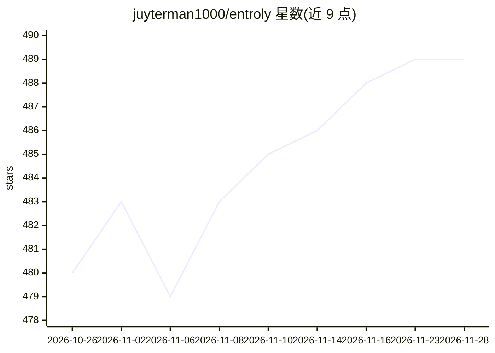

# juyterman1000/entroly

⭐ 489 · Python · Apache-2.0 · 推送 2026-11-27 · [GitHub](https://github.com/juyterman1000/entroly) · [官网](https://juyterman1000.github.io/entroly/docs/index.html) · 个人维护

**为编码 agent 与 LLM 应用做上下文预算与来源校验的本地工具**

Entroly 定位为本地优先的上下文保障与 token 效率工具：在 token 预算内筛选证据并记录保留/省略清单，凭 receipt 从本地内容寻址存储恢复被省略的原始字节，用 WITNESS 标记无来源支撑的声明，并支持跨 agent 恢复未完成工作。通过 pip/npm/brew/docker 及 Rust 源码构建分发，提供 SDK、CLI、代理、MCP 与编辑器插件等接入面；本地检查无需 API key。源码恢复对代码/文档仅返回省略部分而非完整原文。

## 筛选速览

| 维度 | 判定 | 备注 |
|---|---|---|
| AI 角色 | `ai-ecosystem` | LLM/agent 周边工具 |
| 许可风险 | `permissive` | Apache-2.0 |
| 部署形态 | `self-host` | docker 或自建部署 |
| 模型依赖 | — | README 未给出锁定关系 |
| 硬件要求 | — | 无带数字的原话,不猜 |
| 安装摩擦 | `low` | 无编译、无系统依赖或容器化 |
| 成熟度 | — | 结构信号不足 |

## 能力要点

- token 预算内证据选择，receipt 记录保留与省略内容
- verify-claims 本地校验答案是否与来源一致，无需 API key
- entroly-work resume 从仓库证据重建跨 agent 未完成任务
- 代理路径自动压缩逼近上下文上限的长会话，前缀字节稳定

## 适用场景

- 把关键代码塞进 agent 的上下文预算并保留恢复凭据
- 拦截 API 流量压缩请求以减少模型输入 token
- 中途换用另一个编码 agent 时恢复未完成的工作状态
- 校验 AI 回答中的声明是否有源码依据

## 场景标签

`Agent 记忆` · 领域:Agent 开发

## 证据(README 行号)

> L36: Entroly provides context assurance and token-efficiency tooling for AI coding
> L149: |**"I have an API key and my own app."** *(proxy user)*|`entroly proxy` → point `ANTHROPIC_BASE_URL` / `OPENAI_BAS

## 星数曲线

2026-10-26 480 → 2026-11-28 489（+9）

---
*卡片 v1 · prompt 1.4 · 生成 2026-11-28 · 置信度 high · 依据 README sha `f5c814bb4e69` · [字段定义](../../DATASET.md)*
