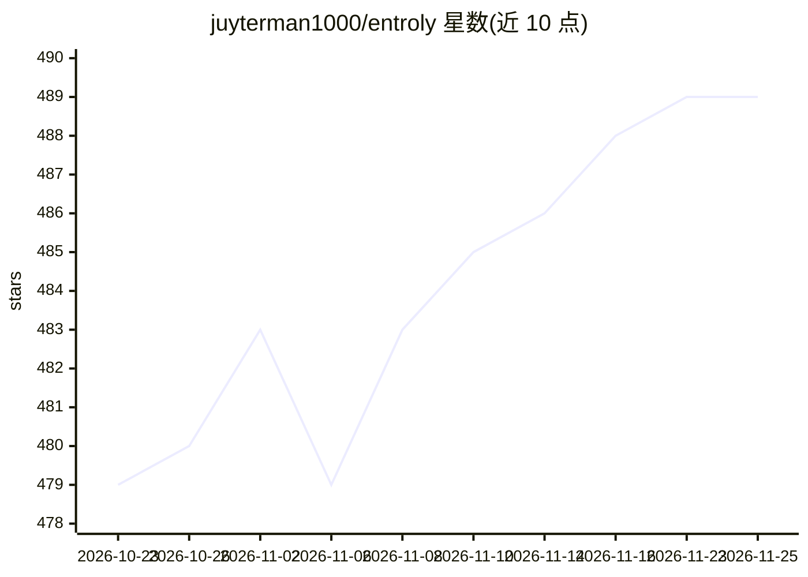

# juyterman1000/entroly

⭐ 489 · Python · Apache-2.0 · 推送 2026-11-23 · [GitHub](https://github.com/juyterman1000/entroly) · [官网](https://juyterman1000.github.io/entroly/docs/index.html) · 个人维护 · 中文 README

**给 AI 编码工具提供可审计、可恢复的上下文压缩层**

Entroly 是本地优先的 AI token 效率与上下文保障层：在 token 预算内选择证据、省略内容保留可恢复句柄、每次选择生成可审计的 receipt。接入方式包括 VS Code/Claude Code/Cursor/Codex 等宿主的 prompt hook、MCP 工具、SDK 调用、本地代理（改写 ANTHROPIC/OPENAI/GEMINI base URL 指向 localhost:9377），以及跨 agent 会话恢复（entroly-work resume）。本地验证命令无需 API key；恢复的完整性依赖本地存储的源字节仍可用。

## 筛选速览

| 维度 | 判定 | 备注 |
|---|---|---|
| AI 角色 | `ai-ecosystem` | LLM/agent 周边工具 |
| 许可风险 | `permissive` | Apache-2.0 |
| 部署形态 | `self-host` | docker 或自建部署 |
| 模型依赖 | — | README 未给出锁定关系 |
| 硬件要求 | — | 无带数字的原话,不猜 |
| 安装摩擦 | `low` | 无编译、无系统依赖或容器化 |
| 成熟度 | — | 结构信号不足 |

## 能力要点

- 每条压缩附 receipt：记录保留、省略内容与恢复句柄
- 本地验证命令 verify-claims/simulate 无需 API key
- 多接入面：pip/npm/brew/Docker/Rust 源码构建、MCP、代理、SDK
- 长会话逼近上下文上限时在代理侧自动压缩（rescue_session）

## 适用场景

- 降低 AI 编码助手的输入 token 成本
- 在多个编码 agent 之间切换时恢复未完成工作
- 在接付费 API 前先在自己仓库上本地模拟压缩效果
- 要求每次上下文删减都有凭据可审计的团队

## 场景标签

 · 领域:开发者工具/LLM 基础设施

## 证据(README 行号)

> L12:  Entroly is an open-source, local-first AI token-efficiency and Context Assurance layer: budgeted evidence selectio
> L33: Entroly is a local-first context control plane for AI coding tools. It selects
> L137: |**"I have an API key and my own app."** *(proxy user)*|`entroly proxy` → point `ANTHROPIC_BASE_URL` / `OPENAI_BAS

## 星数曲线

2026-10-23 479 → 2026-11-25 489（+10）

---
*卡片 v1 · prompt 1.4 · 生成 2026-11-25 · 置信度 high · 依据 README sha `cd04ffbac096` · [字段定义](../../DATASET.md)*
