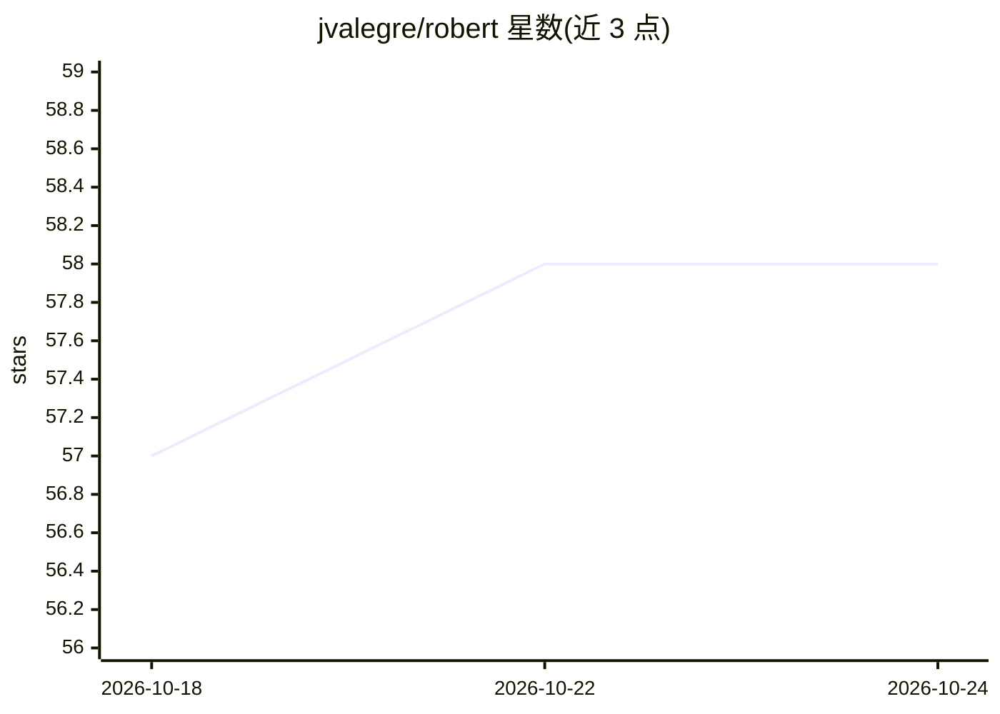

# jvalegre/robert

⭐ 58 · Python · MIT · 推送 2026-10-23 · [GitHub](https://github.com/jvalegre/robert) · 组织维护

**化学研究的一键式自动机器学习工作流：从 CSV 描述符或 SMILES 到可发表结果**

面向化学研究者的自动化机器学习工具：读取描述符 CSV 或 SMILES 输入，通过一条命令自动完成回归模型训练、优化与评估，并生成 PDF 报告（ROBERT_report.pdf）等可发表级结果。基于 scikit-learn、SHAP 与贝叶斯优化等库，强调可复现性（含多轮复现测试）。通过 PyPI 安装，推荐使用 conda 环境，easyROB 模块需额外安装 RDKit，PDF 报告需系统级图形库。由 CSIC 等机构的研究者团队维护，MIT 许可。

## 筛选速览

| 维度 | 判定 | 备注 |
|---|---|---|
| AI 角色 | `ai-native` | 本体是模型或模型工具 |
| 许可风险 | `permissive` | MIT |
| 部署形态 | `library` | 以包/库形式分发 |
| 模型依赖 | — | README 未给出锁定关系 |
| 硬件要求 | — | 无带数字的原话,不猜 |
| 安装摩擦 | `low` | 无编译、无系统依赖或容器化 |
| 成熟度 | — | 结构信号不足 |

## 能力要点

- 一条命令完成从 CSV/SMILES 输入到可发表结果的自动化 ML 工作流
- 生成 PDF 格式报告（ROBERT_report.pdf）
- 基于 scikit-learn、SHAP、贝叶斯优化，含低数据场景工作流
- 配套 Read the Docs 文档与 YouTube 教程

## 适用场景

- 化学研究中从分子描述符数据集自动训练回归模型
- 低数据量场景下运行非线性机器学习工作流
- 生成可直接用于论文的图表与 PDF 报告

## 场景标签

`工作流自动化` `科研工具` · 领域:效率与自动化

## 证据(README 行号)

> L2: ## ROBERT (Refiner and Optimizer of a Bunch of Existing Regression Tools)
> L55: * Dalmau, D.; Alegre Requena, J. V. ROBERT: Bridging the Gap between Machine Learning and Chemistry. *Wiley Interdi

## 星数曲线

2026-10-18 57 → 2026-10-24 58（+1）

---
*卡片 v1 · prompt 1.4 · 生成 2026-10-24 · 置信度 high · 依据 README sha `2cd9b6089f15` · [字段定义](../../DATASET.md)*
