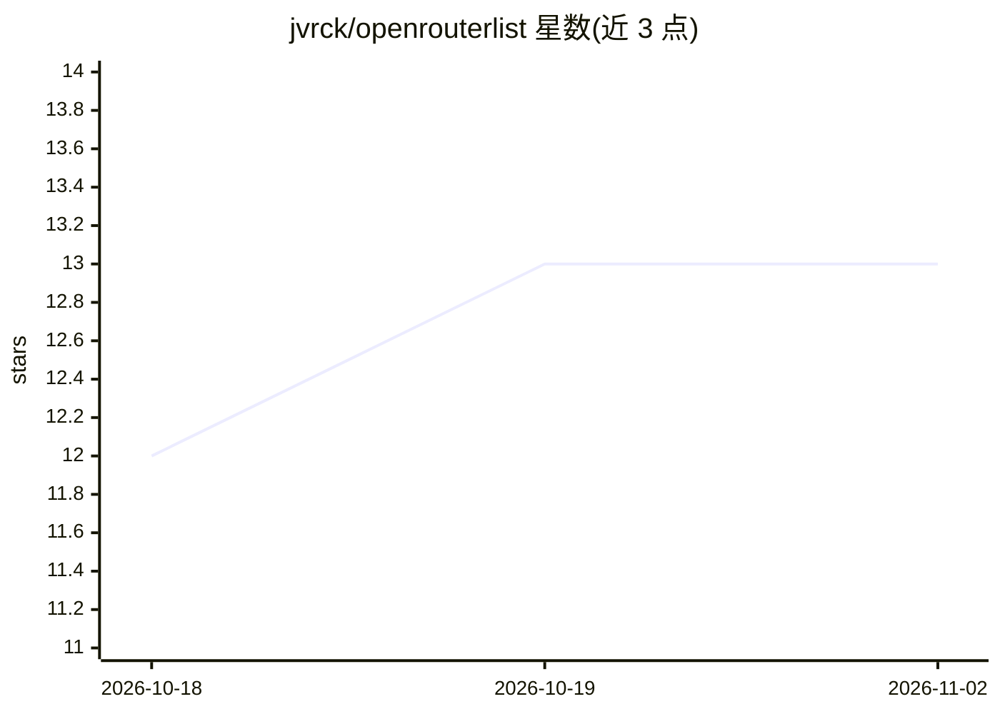

# jvrck/openrouterlist

⭐ 13 · HTML · MIT · 推送 2026-11-01 · [GitHub](https://github.com/jvrck/openrouterlist) · [官网](https://openrouterlist.jvrck.com) · 个人维护

**OpenRouter 模型价格与能力对比的静态站点（468 模型）**

对 OpenRouter API 可用模型做定价与能力对比的静态站点：收录 468 个模型，每日 00:00 与 12:00 UTC 由 GitHub Actions 拉取公开模型列表生成 JSON/CSV 快照、价格历史账本、模型页与文档化 API。功能包括按能力/上下文/价格筛选、最多四模型并排对比、成本计算器（单次到年度工作量，最多十模型）、价格变动追踪（Atom feed）、导出 CSV/Excel，以及供 agent 使用的 llms.txt。面向选择模型或估算工作负载的开发者、研究者与团队。

## 筛选速览

| 维度 | 判定 | 备注 |
|---|---|---|
| AI 角色 | `ai-knowledge` | 知识聚合/清单类 |
| 许可风险 | `permissive` | MIT |
| 部署形态 | `None` |  |
| 模型依赖 | locked-api |  |
| 硬件要求 | — | 无带数字的原话,不猜 |
| 安装摩擦 | `low` | 无编译、无系统依赖或容器化 |
| 成熟度 | — | 结构信号不足 |

## 能力要点

- 每日两次自动更新 468 个模型的价格与能力数据
- 成本计算器支持单次/日/月/年/批量工作量估算（最多十模型）
- 价格历史账本、30 天变动徽章与停用模型归档
- 文档化 /api/models.json 投影与 llms.txt 供 agent 读取

## 适用场景

- 在 468 个 OpenRouter 模型中按价格与能力筛选选型
- 对比多个模型的成本、上下文与能力做决策
- 估算某项 LLM 工作负载的月度/年度费用
- 追踪模型价格变动与上下架情况

## 场景标签

 · 领域:LLM 定价/模型信息

## 证据(README 行号)

> L7: OpenRouterList is a static pricing and capability comparison for the models available through the OpenRouter API. It
> L82: The Daily Run workflow runs at 00:00 and 12:00 UTC, when manually dispatched, and on pushes to `main`. It fetches O
> L40: - Read the documented, versioned `/api/models.json` projection, sorted by model ID with per-million-token prices an

## 星数曲线

2026-10-18 12 → 2026-11-02 13（+1）

---
*卡片 v1 · prompt 1.4 · 生成 2026-11-01 · 置信度 high · 依据 README sha `cc9c31fd7c58` · [字段定义](../../DATASET.md)*
