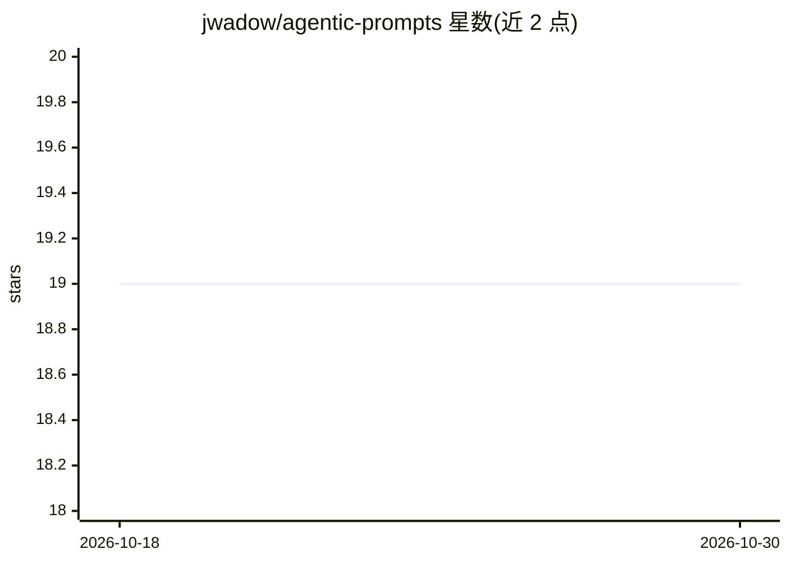

# jwadow/agentic-prompts

⭐ 19 · Python · AGPL-3.0 · 推送 2026-02-28 · [GitHub](https://github.com/jwadow/agentic-prompts) · 个人维护

**AI 编程助手的提示词/模式/命令策展集：可复用配置模板**

个人维护的 AI 编程助手提示词与配置集合：提供 9 个 agent 模式（组成 Pantheon 团队，含编排、架构、实现、测试、安全等角色）、6 个 slash 命令模板（如生成发布说明、创建子代理）及独立提示词模板。采用 Prompt-as-Code 架构，由 roles_builder 目录下的 build.py 脚本从源文件生成 custom_modes.yaml。文件路径结构针对 Roo Code 优化，声称可适配 Cline、Cursor、LibreChat 等多种平台。

## 筛选速览

| 维度 | 判定 | 备注 |
|---|---|---|
| AI 角色 | `ai-knowledge` | 知识聚合/清单类 |
| 许可风险 | `viral` | AGPL-3.0 |
| 部署形态 | `None` |  |
| 模型依赖 | — | README 未给出锁定关系 |
| 硬件要求 | — | 无带数字的原话,不猜 |
| 安装摩擦 | `low` | 无编译、无系统依赖或容器化 |
| 成熟度 | — | 结构信号不足 |

## 能力要点

- 9 个 agent 模式（编排/架构/实现/测试/安全等角色分工）
- 6 个 slash 命令模板（发布说明、外部 LLM 提问、子代理等）
- Prompt-as-Code 架构：build.py 从源文件生成 custom_modes.yaml
- 适配 Roo Code，并列举 Cline/Cursor/Windsurf/LibreChat 等可用平台

## 适用场景

- 为 Roo Code 配置多角色 agent 团队模式
- 为 AI 编程助手添加生成发布说明、子任务分析等命令
- 参考或改编现成的 agent 人设与提示词模板

## 场景标签

`提示工程` `精选清单` · 领域:Agent 开发

## 证据(README 行号)

> L6: **A personal, curated collection of prompts, modes, and configurations for AI coding assistants.**
> L14: This collection contains ready-to-use templates for defining agent personas, delegating tasks, and structuring inte
> L61: > **Note:** While the principles are universal, the specific file paths and structures are optimized for **Roo Code

## 星数曲线

2026-10-18 19 → 2026-10-30 19（+0）

---
*卡片 v1 · prompt 1.4 · 生成 2026-10-28 · 置信度 high · 依据 README sha `2b21b69ba29e` · [字段定义](../../DATASET.md)*
