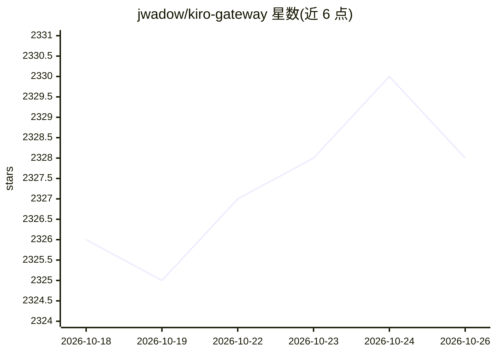

# jwadow/kiro-gateway

⭐ 2,328 · Python · AGPL-3.0 · 推送 2026-05-18 · [GitHub](https://github.com/jwadow/kiro-gateway) · 个人维护 · 中文 README

**把 Kiro（Amazon Q）账号转为 OpenAI/Anthropic 兼容 API 的代理网关**

基于 FastAPI 的本地代理网关（Python 3.10+）：读取 Kiro IDE 凭据文件、AWS SSO 缓存或 kiro-cli SQLite 数据库中的认证信息，将 Kiro API（Amazon Q Developer / AWS CodeWhisperer）暴露为 OpenAI Chat Completions 与 Anthropic Messages 两种兼容端点，供 Claude Code、Cursor、Cline、OpenAI SDK、LangChain 等客户端调用。支持多账号自动故障转移、SSE 流式输出、视觉输入、工具调用、扩展思考与网络搜索，并可经 HTTP/SOCKS5 代理转发请求。模型可用性取决于用户的 Kiro 订阅层级；AGPL v3 许可。

## 筛选速览

| 维度 | 判定 | 备注 |
|---|---|---|
| AI 角色 | `ai-ecosystem` | LLM/agent 周边工具 |
| 许可风险 | `viral` | AGPL-3.0 |
| 部署形态 | `self-host` | docker 或自建部署 |
| 模型依赖 | — | README 未给出锁定关系 |
| 硬件要求 | — | 无带数字的原话,不猜 |
| 安装摩擦 | `low` | 无编译、无系统依赖或容器化 |
| 成熟度 | — | 结构信号不足 |

## 能力要点

- 同时提供 OpenAI /v1/chat/completions 与 Anthropic /v1/messages 兼容端点
- 四种凭据来源：JSON 文件、环境变量、AWS SSO 缓存、kiro-cli SQLite 数据库
- 多账号自动故障转移（429/402 等错误时切换下一账号）
- HTTP/HTTPS/SOCKS5 代理转发，面向受限网络环境

## 适用场景

- 用 Claude Code、Cursor、Cline 等现有客户端调用 Kiro 账号可用的模型
- 国内或企业网络下经代理连接 AWS/Kiro 端点
- 多个 Kiro 账号间做自动切换与配额容错

## 场景标签

`模型网关` · 领域:Agent 开发

## 证据(README 行号)

> L3: **Proxy gateway for Kiro API (Amazon Q Developer / AWS CodeWhisperer)**
> L46: |🔌 **OpenAI-compatible API**|Works with any OpenAI-compatible tool|
> L47: |🔌 **Anthropic-compatible API**|Native `/v1/messages` endpoint|
> L397: |`/v1/messages`|POST|Anthropic Messages API|

## 星数曲线

2026-10-18 2,326 → 2026-10-26 2,328（+2）

---
*卡片 v1 · prompt 1.4 · 生成 2026-10-21 · 置信度 high · 依据 README sha `0e1828fa21d7` · [字段定义](../../DATASET.md)*
