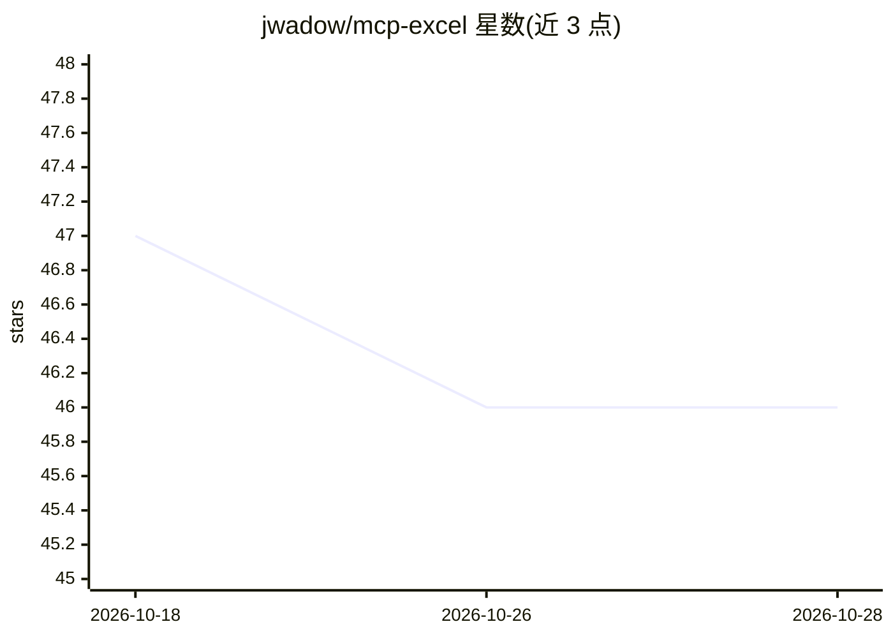

# jwadow/mcp-excel

⭐ 46 · Python · AGPL-3.0 · 推送 2026-02-28 · [GitHub](https://github.com/jwadow/mcp-excel) · 个人维护 · 中文 README

**供 AI agent 分析 Excel 的 MCP 服务器，以原子操作代替灌入上下文**

面向 MCP 兼容 AI agent（OpenCode、Claude Code、Cursor、Cline 等）的 Excel 分析 MCP 服务器：提供 25 个原子操作工具，涵盖文件检查、12+ 种过滤算子、8 种聚合函数、group_by 透视、统计分析（相关系数/离群检测）、排名、数据校验与工作表比对。核心机制是 agent 通过 filter_and_count、aggregate 等查询获得精确结果而非原始行数据，避免上下文溢出；服务在本地运行，原始数据不离开本机。安装需 Python 3.10+，通过 git clone 后以 Poetry/pip/venv 方式部署。

## 筛选速览

| 维度 | 判定 | 备注 |
|---|---|---|
| AI 角色 | `ai-ecosystem` | LLM/agent 周边工具 |
| 许可风险 | `viral` | AGPL-3.0 |
| 部署形态 | `desktop` | 安装包/桌面程序 |
| 模型依赖 | — | README 未给出锁定关系 |
| 硬件要求 | — | 无带数字的原话,不猜 |
| 安装摩擦 | `low` | 无编译、无系统依赖或容器化 |
| 成熟度 | — | 结构信号不足 |

## 能力要点

- 25 个原子操作工具：过滤计数、聚合、透视、统计、排名、比对等
- agent 只接收精确结果与 Excel 公式，不加载原始行数据
- 本地运行，原始数据不离开本机；支持旧版 .xls 与多工作表
- 智能缓存单次加载文件复用于全部操作

## 适用场景

- 让我的 AI agent 直接对大型 Excel 做汇总、筛选和统计分析
- 核对数据质量：查重复、空值、数据校验
- 跨版本工作表 diff 与类别重叠分析

## 场景标签

`数据分析` · 领域:效率与自动化

## 证据(README 行号)

> L3: **Fast and efficient spreadsheet analysis through atomic operations, built specifically for AI agents**
> L42: Model Context Protocol is an open standard that lets AI agents use external tools.
> L44: This project is such a tool. When you connect this server to your AI agent (OpenCode, Claude Code, Codex app, Curso

## 星数曲线

2026-10-18 47 → 2026-10-28 46（-1）

---
*卡片 v1 · prompt 1.4 · 生成 2026-10-25 · 置信度 mid · 依据 README sha `8bc73fc490f7` · [字段定义](../../DATASET.md)*
