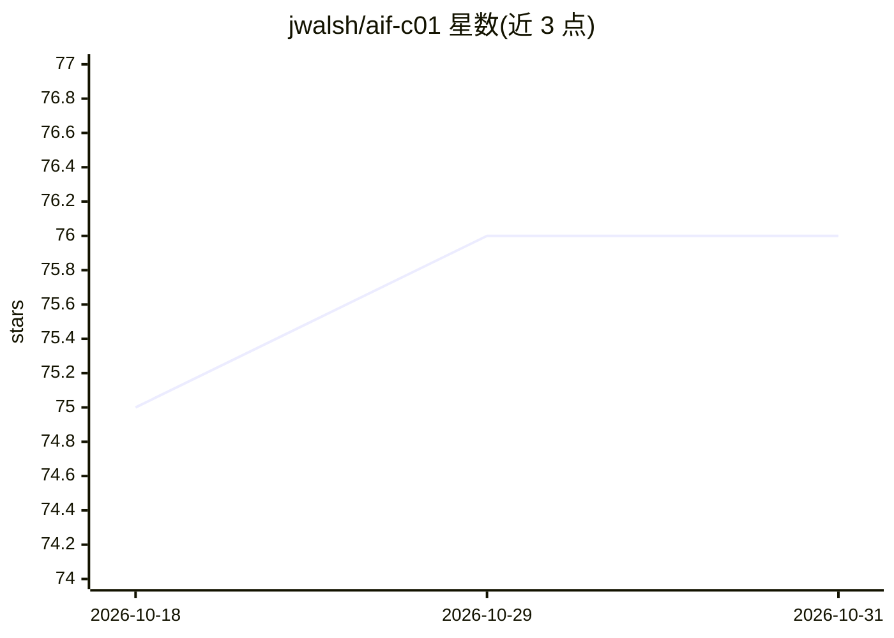

# jwalsh/aif-c01

⭐ 76 · Python · MIT · 推送 2026-10-26 · [GitHub](https://github.com/jwalsh/aif-c01) · 个人维护

**AWS AIF-C01 认证备考资料库：分域学习路径与动手示例**

面向 AWS Certified AI Practitioner (AIF-C01) 考试的备考项目，按考试五个域（AI/ML 基础、生成式 AI 基础、基础模型应用、负责任 AI、安全合规）组织结构化学习材料与 Clojure REPL 可调用的代码示例，兼含 MLA-C01 方向的辅助信息。开发环境用 Nix/direnv + Poetry(Python) + Leiningen(Clojure) 搭建，支持 LocalStack 本地模拟 AWS 服务与真实 AWS 凭证两种配置，通过 Makefile 管理安装与运行，示例覆盖 S3、Bedrock 等服务的 CLI 操作。

## 筛选速览

| 维度 | 判定 | 备注 |
|---|---|---|
| AI 角色 | `ai-knowledge` | 知识聚合/清单类 |
| 许可风险 | `permissive` | MIT |
| 部署形态 | `None` |  |
| 模型依赖 | — | README 未给出锁定关系 |
| 硬件要求 | — | 无带数字的原话,不猜 |
| 安装摩擦 | `low` | 无编译、无系统依赖或容器化 |
| 成熟度 | — | 结构信号不足 |

## 能力要点

- 按 AIF-C01 五个考试域组织的结构化学习路径与 REPL 示例
- LocalStack 本地模拟 AWS 服务，或切换至真实 AWS 配置
- Python(Poetry) 与 Clojure(Leiningen) 双语言开发环境，Makefile 驱动
- 覆盖 Amazon Bedrock、S3 等 AWS 服务的 CLI 操作示例

## 适用场景

- 系统备考 AWS Certified AI Practitioner (AIF-C01) 认证
- 在本地 LocalStack 环境中动手练习 AWS AI/ML 服务操作
- 为 MLA-C01 机器学习工程师认证打基础

## 场景标签

`教程课程` · 领域:学习与行业

## 证据(README 行号)

> L8: This project provides comprehensive study materials, code examples, and a robust development environment for prepari
> L11: - Structured learning paths covering all AIF-C01 exam domains
> L265: This project includes examples and study materials for the following AWS services relevant to the AIF-C01 exam.

## 星数曲线

2026-10-18 75 → 2026-10-31 76（+1）

---
*卡片 v1 · prompt 1.4 · 生成 2026-10-24 · 置信度 high · 依据 README sha `6d1dd7d1faf4` · [字段定义](../../DATASET.md)*
