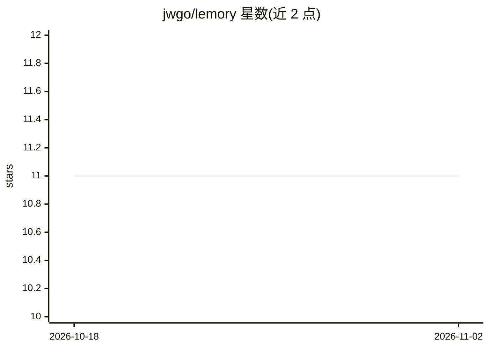

# jwgo/lemory

⭐ 11 · Python · MIT · 推送 2026-08-24 · [GitHub](https://github.com/jwgo/lemory) · [官网](https://jwgo.github.io/lemory/) · 个人维护

**本地优先的 AI 代理记忆中间件：把 Markdown 笔记库变成 MCP 记忆**

面向 AI 代理的本地上下文数据库：将用户文件夹中的 Markdown 文件（含 Obsidian 库）作为记忆、知识与技能的统一存储，无托管数据库、无账户与配额。提供 MCP 服务端（20 个读写工具）、CLI 与 Web 仪表盘，可接入 Claude Code/Desktop、Cursor、Windsurf 等 MCP 客户端，也提供 OpenAI 兼容代理端点。检索为语义+韩语特化关键词+维基链接图+时间窗的四路混合融合，索引阶段无需 LLM 调用；含 L0/L1/L2 分层加载与记忆金字塔（会话→事实→场景→人格）机制。Python 3.10+，需 pipx 从 Git 仓库安装。

## 筛选速览

| 维度 | 判定 | 备注 |
|---|---|---|
| AI 角色 | `ai-ecosystem` | LLM/agent 周边工具 |
| 许可风险 | `permissive` | MIT |
| 部署形态 | `self-host` | docker 或自建部署 |
| 模型依赖 | local-ok | 支持本地模型 |
| 硬件要求 | — | 无带数字的原话,不猜 |
| 安装摩擦 | `low` | 无编译、无系统依赖或容器化 |
| 成熟度 | — | 结构信号不足 |

## 能力要点

- Markdown 文件本体即存储，通过 MCP（20 个工具）、CLI、REST、OpenAI 兼容代理供代理读写
- 索引阶段 LLM 调用 0 次，混合检索（语义/韩语 BM25/链接图/时间窗）默认无 API key 运行
- L0/L1/L2 分层加载与记忆金字塔（会话→事实→场景→人格），LLM 缺席时走确定性回退
- 无 LLM 时仍可完全离线运行；含交互式知识图谱导出与仪表盘

## 适用场景

- 把现有 Obsidian 笔记库直接变成 AI 代理可检索的记忆
- 让 Claude Code/Cursor 等客户端跨会话保留决策、错误与偏好记忆
- 通过 OpenAI 兼容代理为不支持 MCP 的工具附加记忆能力

## 场景标签

`Agent 记忆` · 领域:Agent 开发

## 证据(README 行号)

> L19: **Lemory는 AI 에이전트를 위한 로컬 컨텍스트 데이터베이스입니다.** 에이전트가
> L161: claude mcp add lemory -- lemory mcp --vault ~/Obsidian/MyVault --client claude-desktop
> L175: 툴은 20개입니다. 읽기: `search_notes` · `ask_notes` · `recent_notes` ·

## 星数曲线

2026-10-18 11 → 2026-11-02 11（+0）

---
*卡片 v1 · prompt 1.4 · 生成 2026-11-02 · 置信度 mid · 依据 README sha `f6fbd23483e0` · [字段定义](../../DATASET.md)*
