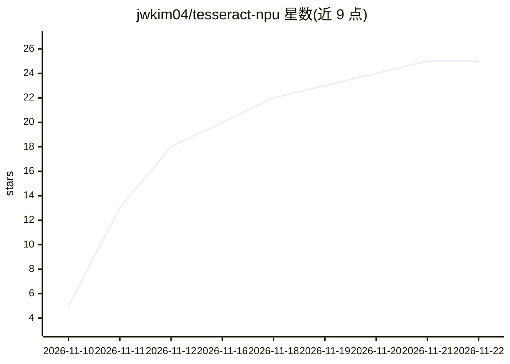

# jwkim04/tesseract-npu

⭐ 25 · C++ · Apache-2.0 · 推送 2026-11-18 · [GitHub](https://github.com/jwkim04/tesseract-npu) · 个人维护

**开源全栈 FPGA NPU，用于在 AMD Alveo U200 上运行 LLM 推理**

包含 SystemVerilog 编写的 NPU 核心（带片上 RISC-V 控制核）、C++20 固件运行时与内核 SDK、以及 ggml-tesseract 后端的完整软硬件栈。通过 llama.cpp 以 -ngl 方式运行 GGUF 模型，另提供 PyTorch 后端（torch.compile backend="tesseract"）、图调度器 Tesseract Pivot、位精确模拟器与 tsr-selftest/tsr-prof 等工具。实现于 AMD Alveo U200 FPGA（32 GiB DDR4），支持 MUL_MAT、FLASH_ATTN_EXT、MoE 路由、Gated DeltaNet 等算子及多 token 预测。面向具备 FPGA 硬件并希望自建 LLM 推理加速的开发者与科研用户，需从源码构建并部署到指定加速卡。

## 筛选速览

| 维度 | 判定 | 备注 |
|---|---|---|
| AI 角色 | `ai-ecosystem` | LLM/agent 周边工具 |
| 许可风险 | `permissive` | Apache-2.0 |
| 部署形态 | `None` |  |
| 模型依赖 | local-ok | 支持本地模型 |
| 硬件要求 | — | 无带数字的原话,不猜 |
| 安装摩擦 | `medium` | 含编译或系统依赖之一 |
| 成熟度 | — | 结构信号不足 |

## 能力要点

- NPU 核心 RTL + Basis 固件 + ggml-tesseract 后端的全栈开源实现
- 经 llama.cpp 运行 GGUF 模型，PyTorch torch.compile 后端可选
- 位精确模拟器与 tsr-selftest/tsr-prof/tsr-top 等验证和调试工具
- 支持多 token 预测（MTP）与 MoE、Gated DeltaNet 等算子

## 适用场景

- 在 AMD Alveo U200 上离线运行 GGUF 量化的 LLM
- 用 PyTorch 后端将模型的部分图区域卸载到 NPU
- 基于 Basis 内核 SDK 开发自定义加速内核
- 在流片/购卡前用位精确模拟器评估设计

## 场景标签

`推理引擎` · 领域:训练与推理

## 证据(README 行号)

> L10: A full-stack, open-source NPU for LLM inference.
> L16: Runs GGUF models as shipped through llama.cpp with `-ngl`. Implemented on an AMD Alveo U200 FPGA. The U200 card hol
> L106: - PyTorch backend. `torch.compile(model, backend="tesseract")` runs regions of a model's aten graph on the device,

## 星数曲线

2026-11-10 5 → 2026-11-22 25（+20）

---
*卡片 v1 · prompt 1.4 · 生成 2026-11-18 · 置信度 high · 依据 README sha `c3be83ffce73` · [字段定义](../../DATASET.md)*
