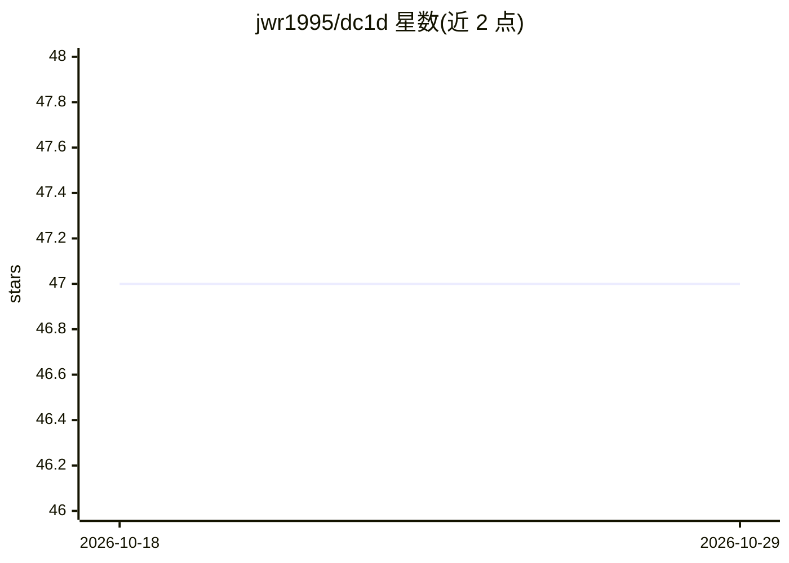

# jwr1995/dc1d

⭐ 47 · Python · MIT · 推送 2026-08-07 · [GitHub](https://github.com/jwr1995/dc1d) · 个人维护

**纯 PyTorch 实现的 1D 可变形卷积层库**

提供 DeformConv1d 与 PackedDeformConv1d 两类一维可变形卷积层，纯 Python 实现，无需编译 C++/CUDA，依赖 torch.autograd 完成反向传播。代码风格模仿 torch.nn.Conv1d 与 torchvision.ops.DeformConv2d；PackedDeformConv1d 内部用深度可分离卷积块计算偏移。支持 DCNv2 调制、ONNX 导出（dynamo 导出器、长度无关图）、torch.compile 与内存换算力的重计算反向。论文版本需锁 dc1d<=0.0.4。

## 筛选速览

| 维度 | 判定 | 备注 |
|---|---|---|
| AI 角色 | `ai-native` | 本体是模型或模型工具 |
| 许可风险 | `permissive` | MIT |
| 部署形态 | `library` | 以包/库形式分发 |
| 模型依赖 | — | README 未给出锁定关系 |
| 硬件要求 | — | 无带数字的原话,不猜 |
| 安装摩擦 | `medium` | 含编译或系统依赖之一 |
| 成熟度 | — | 结构信号不足 |

## 能力要点

- 纯 PyTorch 实现，无 C++/CUDA 编译步骤
- 支持 DCNv2 调制与内部计算偏移的 PackedDeformConv1d
- ONNX 导出无自定义算子且导出图长度无关
- torch.compile 下前向加速 2.3-9.1×（RTX 3090）

## 适用场景

- 在时序/音频模型中替换标准 1D 卷积以获得可学习采样位置
- 复现 DTCN 论文中的 depthwise 偏移配置
- 将 1D 可变形卷积导出为 ONNX 部署

## 场景标签

 · 领域:深度学习/时序建模

## 证据(README 行号)

> L27: A 1D implementation of a deformable convolutional layer implemented in pure Python in PyTorch. The code style is de
> L31: The motivation for creating this toolkit is that (as of 19/10/2022) there is no native 1D implementation of deforma

## 星数曲线

2026-10-18 47 → 2026-10-29 47（+0）

---
*卡片 v1 · prompt 1.4 · 生成 2026-10-25 · 置信度 high · 依据 README sha `57418bbe913a` · [字段定义](../../DATASET.md)*
