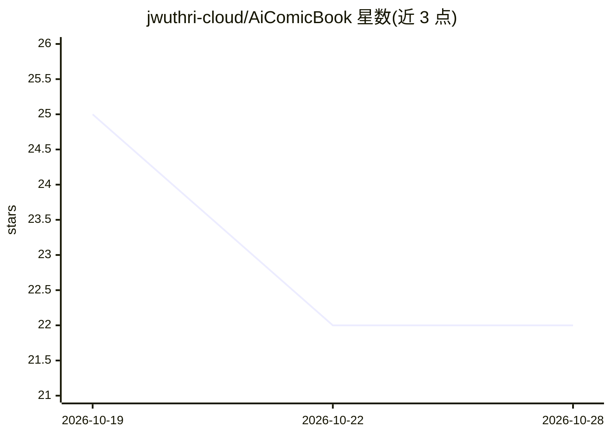

# jwuthri-cloud/AiComicBook

⭐ 22 · Swift · MIT · 推送 2026-10-26 · [GitHub](https://github.com/jwuthri-cloud/AiComicBook) · [官网](https://ai-comic-book-topaz.vercel.app) · 个人维护

**AI/ML 等技术主题的漫画风格学习速查图集**

以 PNG 赛博朋克风格漫画速查图组成的系列学习资料库：内容覆盖机器学习与 LLM 内部机制、LeetCode 算法模式、Git/Docker/Kubernetes 等软件工程基础、Redwood Research AI Futurism 阅读清单提炼的 35 张卡、126 幅 AI 安全图解，以及 Anthropic fellowship 多页漫画研究项目说明。README 同时给出视觉风格规范、新主题创作模板、图像生成提示词与工作流清单，并说明配套 SwiftUI 阅读应用 Panels。

## 筛选速览

| 维度 | 判定 | 备注 |
|---|---|---|
| AI 角色 | `ai-knowledge` | 知识聚合/清单类 |
| 许可风险 | `permissive` | MIT |
| 部署形态 | `None` |  |
| 模型依赖 | — | README 未给出锁定关系 |
| 硬件要求 | — | 无带数字的原话,不猜 |
| 安装摩擦 | `low` | 无编译、无系统依赖或容器化 |
| 成熟度 | — | 结构信号不足 |

## 能力要点

- 按主题组织的 PNG 漫画速查图集（ML/LeetCode/SWE/Futurism/AI 安全等）
- AI 安全 126 幅图解与 Redwood Futurism 阅读清单 35 张卡
- 提供可复用的新主题创作简报、图像生成提示词与质量检查清单

## 适用场景

- 快速扫描理解 ML、LLM、AI 安全等主题的核心概念
- 备考 LeetCode 或复习 Git/系统设计等工程基础
- 按给定风格模板与工作流创作新的速查图页

## 场景标签

`教程课程` · 领域:学习与行业

## 证据(README 行号)

> L9: The repository contains PNG artwork organized into subject collections:
> L15: - **ai safety/** — 126 illustrated explanations of alignment, training, interpretability, oversight, evaluations, a

## 星数曲线

2026-10-19 25 → 2026-10-28 22（-3）

---
*卡片 v1 · prompt 1.4 · 生成 2026-10-27 · 置信度 high · 依据 README sha `4f4342687ff8` · [字段定义](../../DATASET.md)*
