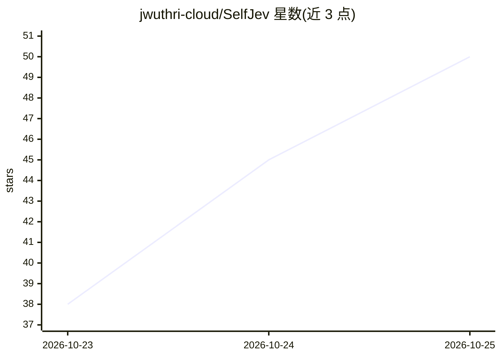

# jwuthri-cloud/SelfJev

⭐ 50 · Python · Apache-2.0 · 推送 2026-10-21 · [GitHub](https://github.com/jwuthri-cloud/SelfJev) · [官网](https://www.selfjev.dev) · 个人维护

**自托管 4B 决策模型：把文本与问题转为结构化决策输出**

SelfJev 是一个自托管的决策模型（selfjev-4b，基于 Qwen3.5-4B 加 rank-64 LoRA 适配器）：读取一次文档后，对用户定义的问题与候选答案直接打分，返回 Noul/Choice/Score/Multi 四种带概率的类型化答案，覆盖请求路由、AI 回复审查、规则适用等场景。提供 Python SDK 与 Jev 兼容 HTTP API，含服务器、LoRA 微调与 RLCD 训练命令。自建服务需 NVIDIA GPU（参考配置 24 GB 显存、16–32 GB 内存、50 GB 磁盘），8 GB 卡可用 4-bit 量化版。评测集 Decision Bench 公开发布。

## 筛选速览

| 维度 | 判定 | 备注 |
|---|---|---|
| AI 角色 | `ai-native` | 本体是模型或模型工具 |
| 许可风险 | `permissive` | Apache-2.0 |
| 部署形态 | `library` | 以包/库形式分发 |
| 模型依赖 | local-ok | 支持本地模型 |
| 硬件要求 | — | 无带数字的原话,不猜 |
| 安装摩擦 | `medium` | 含编译或系统依赖之一 |
| 成熟度 | — | 结构信号不足 |

## 能力要点

- Qwen3.5-4B + rank-64 LoRA，共享前缀树复用文档与问题计算
- Noul/Choice/Score/Multi 四种类型化答案，直接输出概率不生成文本
- 兼容 Jev/TypeSafe SDK 接口与 OpenRouter decisions 路径
- selfjev finetune / selfjev rlcd 微调与校准训练，vLLM 后端可选

## 适用场景

- 在自有 GPU 上做客户请求意图路由与团队分派
- 审查 AI 回复的事实支持与策略违规并给出概率
- 基于自有标注数据微调适配业务词表与规则

## 场景标签

`模型评测` `微调` · 领域:评测与运维

## 证据(README 行号)

> L11: **SelfJev turns text and questions into decisions your code can use.** Route a request, check an AI response, or ap
> L98: SelfJev-4B combines **Qwen3.5-4B** with a trained **rank-64 LoRA adapter**. Its shared-prefix tree reuses the docum

## 星数曲线

2026-10-23 38 → 2026-10-25 50（+12）

---
*卡片 v1 · prompt 1.4 · 生成 2026-10-24 · 置信度 high · 依据 README sha `ee1e87a03aec` · [字段定义](../../DATASET.md)*
