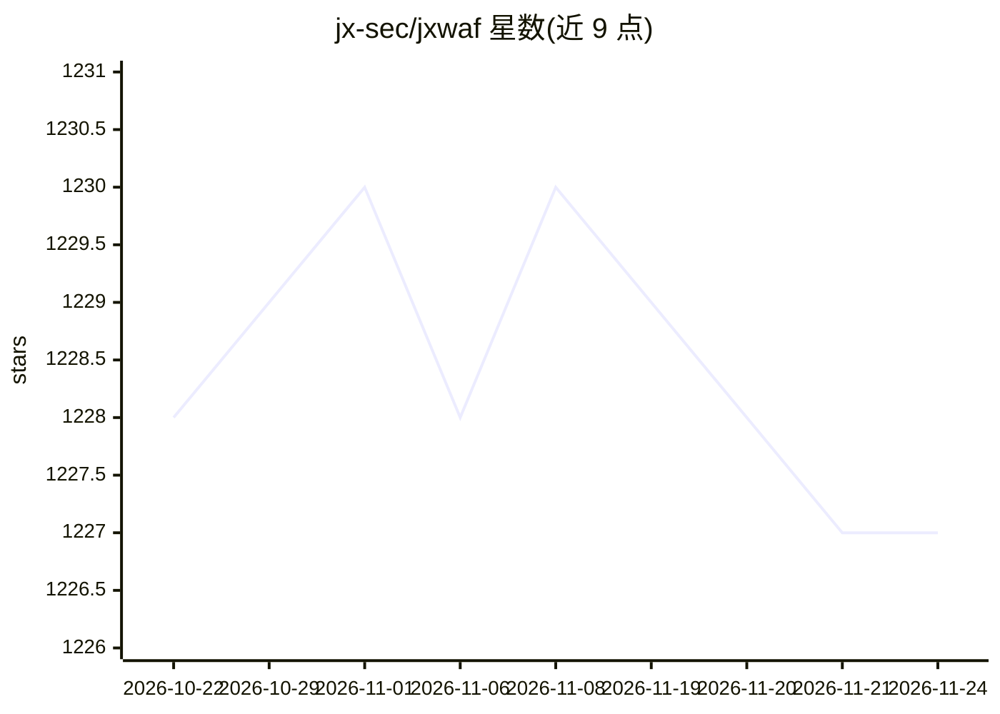

# jx-sec/jxwaf

⭐ 1,227 · Go Template · GPL-2.0 · 推送 2026-11-21 · [GitHub](https://github.com/jx-sec/jxwaf) · [官网](https://www.jxwaf.com/) · 组织维护 · 中文 README

**基于 AI 大模型的 Web 应用防火墙，检测恶意流量**

开源的 Web 应用防火墙，实时分析检测 Web 应用流量，清洗恶意流量后转发正常流量至业务服务器。核心机制包括多维稀疏注意力与在线蒸馏的 AI 安全模型（继承大模型检测能力至本地推理引擎，纯 CPU 运行）、语义分析引擎（防御 SQL 注入、XSS、命令执行等）、SSL 行为分析与 WebTDS 毫秒级实时威胁分析。提供标准版（单机 Docker 编排）、专业版（控制台/节点/日志分离部署）与 WebTDS 三条产品线；防护模式支持模型训练、日常防护、重保防护与离线防护切换。

## 筛选速览

| 维度 | 判定 | 备注 |
|---|---|---|
| AI 角色 | `ai-native` | 本体是模型或模型工具 |
| 许可风险 | `viral` | GPL-2.0 |
| 部署形态 | `self-host` | docker 或自建部署 |
| 模型依赖 | — | README 未给出锁定关系 |
| 硬件要求 | — | 无带数字的原话,不猜 |
| 安装摩擦 | `low` | 无编译、无系统依赖或容器化 |
| 成熟度 | — | 结构信号不足 |

## 能力要点

- AI 安全模型支持 0day 自动检测与误报自动处理，纯 CPU 运行
- 语义分析引擎防御 SQL 注入、XSS、命令/代码执行、反序列化等攻击
- 标准版单机一键 Docker 编排部署，专业版支持节点集群水平扩展
- 四种防护模式可切换：模型训练/日常防护/重保防护/离线防护

## 适用场景

- 为个人站点或企业业务部署 Web 应用防火墙
- 检测并拦截 SQL 注入、XSS 等攻击流量
- 进行 CC 检测、爬虫对抗与业务风控
- 通过私有化部署模型服务处理检测流量

## 场景标签

`网络安全` · 领域:学习与行业

## 证据(README 行号)

> L5: 基于 AI 大模型的 Web 应用防火墙（WAF）。实时分析检测 Web 应用流量，清洗恶意流量后将正常流量转发至业务服务器，保障业务安全稳定运行。
> L16: - **AI 安全模型**：多维稀疏注意力 + 在线蒸馏，将大模型检测能力继承至本地推理引擎，支持 0day 自动检测与误报自动处理，纯 CPU 运行。

## 星数曲线

2026-10-22 1,228 → 2026-11-24 1,227（-1）

---
*卡片 v1 · prompt 1.4 · 生成 2026-11-23 · 置信度 high · 依据 README sha `09a799b15f5c` · [字段定义](../../DATASET.md)*
