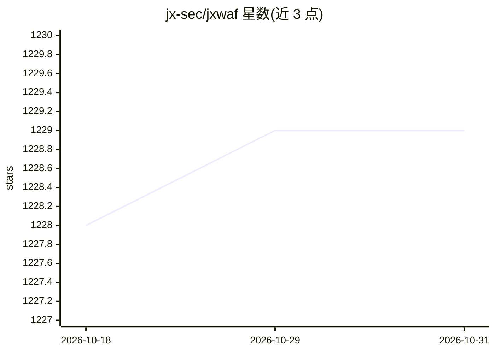

# jx-sec/jxwaf

⭐ 1,229 · Go Template · GPL-2.0 · 推送 2026-10-30 · [GitHub](https://github.com/jx-sec/jxwaf) · [官网](https://www.jxwaf.com/) · 组织维护 · 中文 README

**基于 AI 大模型的 Web 应用防火墙，清洗恶意流量后转发业务服务器**

JXWAF 是一款反向代理式 Web 应用防火墙，实时分析检测 Web 流量、拦截恶意请求后转发至业务服务器。检测侧包含 AI 安全模型（自研多维稀疏注意力与在线蒸馏，支持 0day 自动检测与误报自动处理）、语义分析引擎和 SSL 行为分析引擎。提供三个版本：标准版（单机 docker compose 一键部署、免费）、专业版（控制台/节点/日志分离部署）与云WAF（多租户、CNAME 自动接入、CDN）。默认使用官方安全模型服务，推理费用由平台承担；纯 CPU 即可部署，最低 4 核 8G。面向个人站点到中大型企业用户。

## 筛选速览

| 维度 | 判定 | 备注 |
|---|---|---|
| AI 角色 | `ai-enhanced` | 去掉 AI 部分产品仍成立 |
| 许可风险 | `viral` | GPL-2.0 |
| 部署形态 | `self-host` | docker 或自建部署 |
| 模型依赖 | — | README 未给出锁定关系 |
| 硬件要求 | — | 无带数字的原话,不猜 |
| 安装摩擦 | `low` | 无编译、无系统依赖或容器化 |
| 成熟度 | — | 结构信号不足 |

## 能力要点

- AI 安全模型 + 语义分析 + SSL 行为分析三引擎检测
- 标准版 docker compose 一条命令部署，免费使用
- 支持 0day 自动检测与误报自动处理（在线蒸馏）
- 云WAF 版提供多租户、CNAME 自动接入与 ACME 泛域名证书自动签发

## 适用场景

- 在业务服务器前部署 WAF 拦截 SQL 注入、XSS、CC 攻击等恶意流量
- 企业多部门通过云WAF 统一管理各自域名的安全策略
- 个人或小企业用标准版单机部署获得基础 Web 防护

## 场景标签

`网络安全` · 领域:学习与行业

## 证据(README 行号)

> L5: 基于 AI 大模型的 Web 应用防火墙，实时分析检测 Web 应用流量，清洗恶意流量后转发至业务服务器，保障业务安全稳定运行。
> L51: AI 安全模型 + 语义分析引擎双引擎驱动的 Web 应用防火墙，`docker compose up` 一条命令完成部署，免费使用。
> L59: JXWAF 自研多维稀疏注意力机制与在线蒸馏技术，将 AI 大模型的安全检测能力完整继承至本地推理引擎，实现 **高并发、低成本、低幻觉** 的 Web 安全检测。

## 星数曲线

2026-10-18 1,228 → 2026-10-31 1,229（+1）

---
*卡片 v1 · prompt 1.4 · 生成 2026-10-21 · 置信度 high · 依据 README sha `0100e1c482b8` · [字段定义](../../DATASET.md)*
