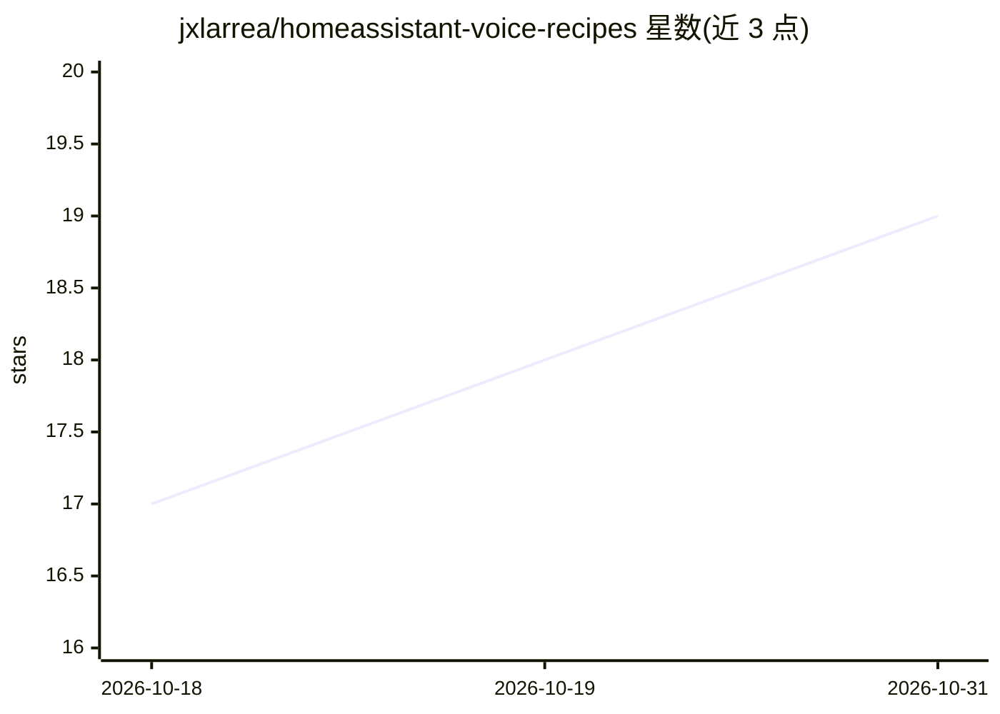

# jxlarrea/homeassistant-voice-recipes

⭐ 19 · Go · MIT · 推送 2026-06-13 · [GitHub](https://github.com/jxlarrea/homeassistant-voice-recipes) · 个人维护

**Home Assistant 本地 GPU 语音控制全栈部署配方**

面向 Home Assistant 用户的 100% 本地语音控制部署方案：以 Docker Compose 配方组织唤醒词检测（OpenWakeWord）、GPU 加速语音识别（ONNX ASR/NeMo Parakeet）、声纹校验与语音提取代理（ECAPA-TDNN）、对话 LLM（Gemma-4-26B 经 llama.cpp 提供 OpenAI 兼容 API，含推测解码与请求分析代理）、TTS（Kokoro FastAPI）及浏览器语音卫星前端，组件经 Wyoming 协议接入 Home Assistant。支持 x86/x64 与 GB10 ARM64（DGX Spark），ARM64 需使用分支 compose 文件或补丁脚本自行构建部分镜像。

## 筛选速览

| 维度 | 判定 | 备注 |
|---|---|---|
| AI 角色 | `ai-ecosystem` | LLM/agent 周边工具 |
| 许可风险 | `permissive` | MIT |
| 部署形态 | `self-host` | docker 或自建部署 |
| 模型依赖 | local-ok | 支持本地模型 |
| 硬件要求 | — | 无带数字的原话,不猜 |
| 安装摩擦 | `low` | 无编译、无系统依赖或容器化 |
| 成熟度 | — | 结构信号不足 |

## 能力要点

- 全链路组件均为 Docker 容器 + NVIDIA GPU 直通，组件间以 Wyoming 协议通信
- Voice Match 代理用 ECAPA-TDNN 声纹校验做说话人过滤，抑制误触发
- LLM 层含 llama-proxy 请求分析（延迟/token/工具调用指标，Web 仪表盘 :9090）
- x86/x64 与 GB10 ARM64（DGX Spark）双架构支持

## 适用场景

- 在自有 GPU 硬件上搭建无云依赖的智能家居语音助手
- 把平板/浏览器变成 Home Assistant 语音终端
- 分析语音对话 LLM 的推理延迟与工具调用情况

## 场景标签

`语音 Agent` · 领域:对话与助手

## 证据(README 行号)

> L3: GPU/CUDA-accelerated voice control stack for Home Assistant. Runs on **x86/x64** and **GB10 ARM64** devices (includi
> L18: Every component runs as a Docker container with NVIDIA GPU passthrough, communicating via the Wyoming protocol - Ho
> L105: The brain of the pipeline. Runs Gemma-4-26B-A4B (Q8_0 quantization) with MTP speculative decoding for significantl

## 星数曲线

2026-10-18 17 → 2026-10-31 19（+2）

---
*卡片 v1 · prompt 1.4 · 生成 2026-10-29 · 置信度 high · 依据 README sha `1cffde25f01e` · [字段定义](../../DATASET.md)*
