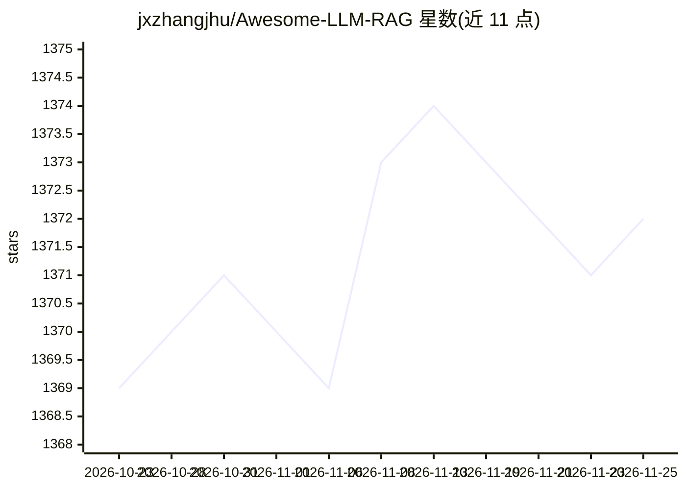

# jxzhangjhu/Awesome-LLM-RAG

⭐ 1,372 · 推送 2026-11-16 · [GitHub](https://github.com/jxzhangjhu/Awesome-LLM-RAG) · 个人维护

**面向 LLM RAG 研究者的论文与资源清单**

以清单形式记录大语言模型检索增强生成（RAG）方向的进阶论文，按综述与基准、检索增强 LLM、指令微调、上下文学习、嵌入等主题分类收录，并附工作坊/教程、书籍和相关开源工具条目。欢迎研究者通过 pull request 提交更新其论文信息。内容以论文条目与链接为主，本身不提供可运行的 RAG 实现或安装步骤。

## 筛选速览

| 维度 | 判定 | 备注 |
|---|---|---|
| AI 角色 | `ai-knowledge` | 知识聚合/清单类 |
| 许可风险 | `permissive` | — |
| 部署形态 | `library` | 以包/库形式分发 |
| 模型依赖 | — | README 未给出锁定关系 |
| 硬件要求 | — | 无带数字的原话,不猜 |
| 安装摩擦 | `low` | 无编译、无系统依赖或容器化 |
| 成熟度 | — | 结构信号不足 |

## 能力要点

- 按主题分类收录 RAG 论文（综述基准、检索增强 LLM、微调、嵌入等）
- 收录教程、书籍与相关开源工具资源
- 接受研究者通过 pull request 更新论文条目
- MIT 许可

## 适用场景

- 查找 RAG 方向的论文与基准作为研究入口
- 了解 RAG 领域的教程与书籍资源
- 调研 RAG 嵌入与检索技术的相关工具

## 场景标签

`精选清单` · 领域:学习与行业

## 证据(README 行号)

> L8: This repo aims to record advanced papers on Retrieval Augmented Generation (RAG) in LLMs.
> L101: # Papers
> L105: **Benchmarking Large Language Models in Retrieval-Augmented Generation** \

## 星数曲线

2026-10-23 1,369 → 2026-11-25 1,372（+3）

---
*卡片 v1 · prompt 1.4 · 生成 2026-11-23 · 置信度 mid · 依据 README sha `244ce960a3b8` · [字段定义](../../DATASET.md)*
