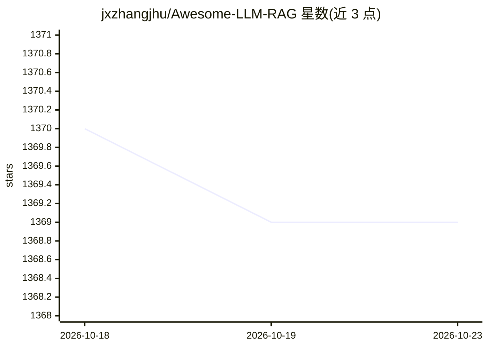

# jxzhangjhu/Awesome-LLM-RAG

⭐ 1,369 · 推送 2026-10-21 · [GitHub](https://github.com/jxzhangjhu/Awesome-LLM-RAG) · 个人维护

**LLM RAG 论文与资源策展清单，面向科研者**

Awesome 系列的 RAG 主题策展仓库：收录检索增强生成方向的学术论文（按综述/基准、检索增强 LLM、指令微调、上下文学习、嵌入、模拟器等类别组织）、工作坊与教程、书籍（Manning 等出版社的 RAG 主题书目），并附工具资源列表。条目标注作者、发表会议/时间与论文/代码链接，通过 PR 接收社区更新。面向做 RAG 研究与选型的科研人员和开发者，仓库本身无可运行代码，仅 MIT 许可的内容清单。

## 筛选速览

| 维度 | 判定 | 备注 |
|---|---|---|
| AI 角色 | `ai-knowledge` | 知识聚合/清单类 |
| 许可风险 | `permissive` | — |
| 部署形态 | `library` | 以包/库形式分发 |
| 模型依赖 | — | README 未给出锁定关系 |
| 硬件要求 | — | 无带数字的原话,不猜 |
| 安装摩擦 | `low` | 无编译、无系统依赖或容器化 |
| 成熟度 | — | 结构信号不足 |

## 能力要点

- 按 8+ 个学术类别组织 RAG 论文条目，含作者与会议/时间标注
- 收录 RAG 主题书籍（含免费电子书）与工作坊教程
- 工具资源区收录分块调优、ETL 索引构建、文档压缩等开源项目
- 通过 pull request 接收研究者自荐论文更新

## 适用场景

- 查找 RAG 方向的经典与最新论文
- 了解 RAG 相关书籍与教程资源
- 按类别（嵌入、微调、检索增强等）浏览研究脉络

## 场景标签

`精选清单` · 领域:学习与行业

## 证据(README 行号)

> L8: This repo aims to record advanced papers on Retrieval Augmented Generation (RAG) in LLMs.
> L97: # Papers

## 星数曲线

2026-10-18 1,370 → 2026-10-23 1,369（-1）

---
*卡片 v1 · prompt 1.4 · 生成 2026-10-21 · 置信度 mid · 依据 README sha `fdec52ff3891` · [字段定义](../../DATASET.md)*
