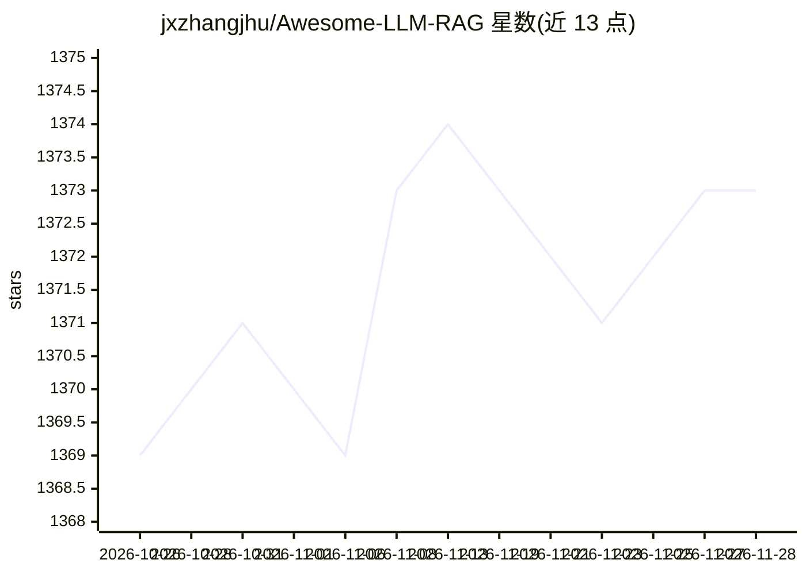

# jxzhangjhu/Awesome-LLM-RAG

⭐ 1,373 · 推送 2026-11-26 · [GitHub](https://github.com/jxzhangjhu/Awesome-LLM-RAG) · 个人维护

**面向 LLM 研究者收录 RAG 前沿论文与学习资源的策展清单**

该仓库以清单形式记录 LLM 中检索增强生成（RAG）方向的论文，按综述与基准、检索增强 LLM、指令微调、上下文学习、嵌入等主题分区组织，每条含作者、会议/期刊与链接；另收录工作坊与教程、书籍（Manning 出版物、免费电子书）以及开源工具条目，并鼓励研究者通过 pull request 提交自己的论文信息。仓库本身不含可运行代码，MIT 许可。

## 筛选速览

| 维度 | 判定 | 备注 |
|---|---|---|
| AI 角色 | `ai-knowledge` | 知识聚合/清单类 |
| 许可风险 | `permissive` | — |
| 部署形态 | `library` | 以包/库形式分发 |
| 模型依赖 | — | README 未给出锁定关系 |
| 硬件要求 | — | 无带数字的原话,不猜 |
| 安装摩擦 | `low` | 无编译、无系统依赖或容器化 |
| 成熟度 | — | 结构信号不足 |

## 能力要点

- 按 Survey/Benchmark、Retrieval-enhanced LLM、Instruction Tuning、Embeddings 等主题分区的论文清单
- 收录工作坊教程、书籍与免费电子书等学习资源分区
- 含 ChunkTuner、CocoIndex、docs-rag-mcp 等 RAG 相关开源工具条目
- 开放 pull request 供研究者更新论文信息

## 适用场景

- 查找 RAG 方向的论文与会议资源
- 按主题调研检索增强生成的技术脉络
- 寻找 RAG 分块、索引、评测相关的开源工具与教程

## 场景标签

`精选清单` · 领域:学习与行业

## 证据(README 行号)

> L8: This repo aims to record advanced papers on Retrieval Augmented Generation (RAG) in LLMs.
> L12: ## Contents
> L102: # Papers

## 星数曲线

2026-10-26 1,369 → 2026-11-28 1,373（+4）

---
*卡片 v1 · prompt 1.4 · 生成 2026-11-27 · 置信度 mid · 依据 README sha `135369ecd778` · [字段定义](../../DATASET.md)*
