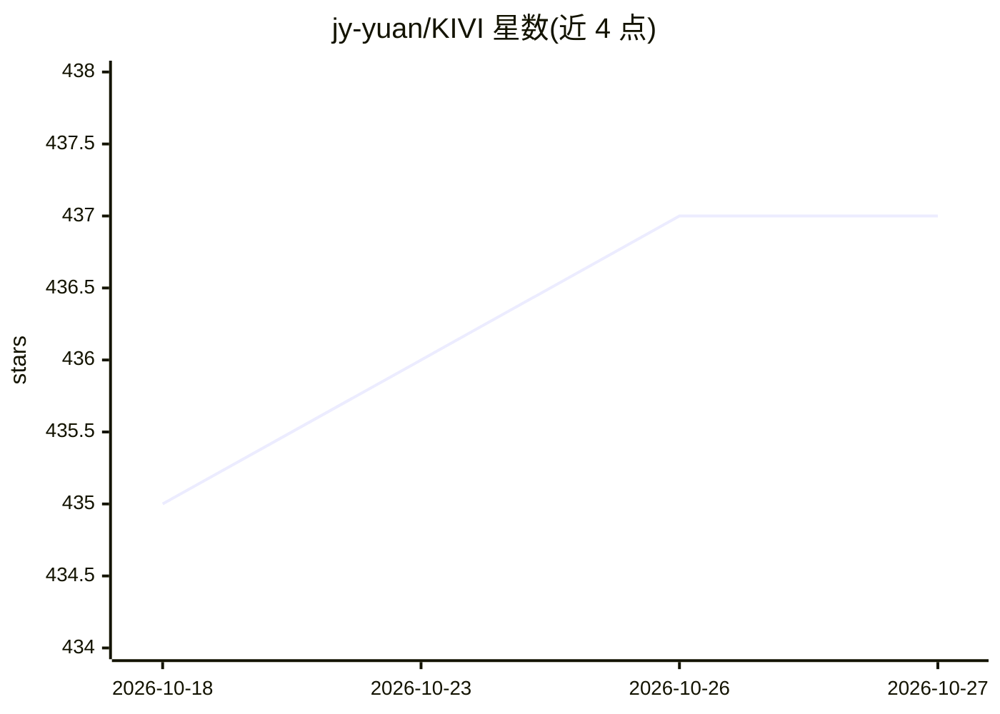

# jy-yuan/KIVI

⭐ 437 · Python · MIT · 推送 2025-11-20 · [GitHub](https://github.com/jy-yuan/KIVI) · [官网](https://arxiv.org/abs/2402.02750) · 组织维护

**免调参的 KV Cache 2bit 非对称量化算法实现，降显存提吞吐**

ICML 2024 论文 KIVI 的官方实现：即插即用的 2bit KV cache 量化算法，key cache 按通道、value cache 按词元量化，无需微调。面向在 GPU 上推理 Llama-2、Falcon、Mistral 等模型的开发与研究人员，峰值显存降低 2.6 倍，batch size 可增至 4 倍，推理吞吐提升 2.35-3.47 倍。安装需先装主包再在 quant 目录下安装 CUDA 实现，提供 GSM8K、passkey 检索与 LongBench 评测脚本，兼容 transformers 4.43 并支持 LLama3 与 GQA。

## 筛选速览

| 维度 | 判定 | 备注 |
|---|---|---|
| AI 角色 | `ai-ecosystem` | LLM/agent 周边工具 |
| 许可风险 | `permissive` | MIT |
| 部署形态 | `library` | 以包/库形式分发 |
| 模型依赖 | — | README 未给出锁定关系 |
| 硬件要求 | — | 无带数字的原话,不猜 |
| 安装摩擦 | `medium` | 含编译或系统依赖之一 |
| 成熟度 | — | 结构信号不足 |

## 能力要点

- key 按通道、value 按词元的 2bit 非对称量化，无需微调
- 峰值显存降低 2.6 倍，吞吐提升 2.35-3.47 倍
- 提供 CUDA 实现，支持 Llama-2/Falcon/Mistral（含 GQA 与 LLama3）
- 附带 GSM8K、长上下文 passkey 与 LongBench 评测脚本

## 适用场景

- 在显存受限的 GPU 上跑长上下文 LLM 推理
- 提升 LLM 服务的 batch size 与吞吐
- 复现论文在 GSM8K/LongBench 上的量化评测结果

## 场景标签

`模型量化` · 领域:训练与推理

## 证据(README 行号)

> L29: KIVI is a new plug-and-play 2bit KV cache quantization algorithm without any fine-tuning. This algorithm optimizes 
> L3: Implementation of [ICML24] KIVI: A Tuning-Free Asymmetric 2bit Quantization for KV Cache

## 星数曲线

2026-10-18 435 → 2026-10-27 437（+2）

---
*卡片 v1 · prompt 1.4 · 生成 2026-10-22 · 置信度 high · 依据 README sha `fd0e6b247008` · [字段定义](../../DATASET.md)*
