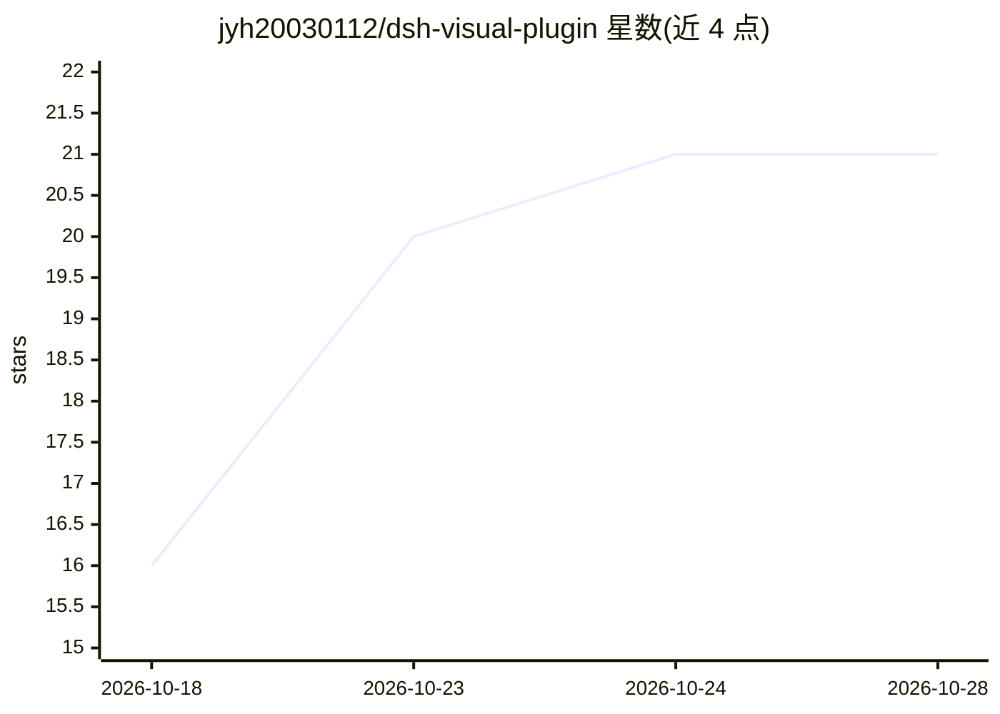

# jyh20030112/dsh-visual-plugin

⭐ 21 · JavaScript · MIT · 推送 2026-10-07 · [GitHub](https://github.com/jyh20030112/dsh-visual-plugin) · 个人维护 · 中文 README

**DeepSeek Harness 的本地优先视觉媒体插件：图像/视频理解与历史记录**

面向 DeepSeek Harness（DSH）的 TypeScript 插件：本地完成视频容器校验、H.264/yuv420p 规范化转码与 PySceneDetect 关键帧抽取，把图像与带时间戳的关键帧通过 DSH 原生附件路径交给当前所选的视觉模型理解；右侧面板记录每张图的缩略图与最终回答（可复制）、播放视频并暂存聊天草稿。插件自身不配置或调用独立的视觉模型，模型提供方与凭据由 DSH 管理。视频功能需另装 FFmpeg/FFprobe>=6.1 与 PySceneDetect>=0.7.1，图像功能无此要求；零运行时依赖，预构建 lib/ 已提交。

## 筛选速览

| 维度 | 判定 | 备注 |
|---|---|---|
| AI 角色 | `ai-ecosystem` | LLM/agent 周边工具 |
| 许可风险 | `permissive` | MIT |
| 部署形态 | `desktop` | 安装包/桌面程序 |
| 模型依赖 | — | README 未给出锁定关系 |
| 硬件要求 | — | 无带数字的原话,不猜 |
| 安装摩擦 | `medium` | 含编译或系统依赖之一 |
| 成熟度 | — | 结构信号不足 |

## 能力要点

- 本地视频校验、H.264 规范化转码与 PySceneDetect 关键帧抽取
- 图像与关键帧走 DSH 原生附件路径，插件不配置独立视觉模型
- 右侧面板记录缩略图与模型回答，支持展开与一键复制
- 零运行时依赖，预构建产物已提交，用户无需构建

## 适用场景

- 在 DSH 网页端发送图片并获得可复制的回答历史
- 把本地视频转码抽帧后交给当前视觉模型分析
- 在右侧面板回放规范化后的视频并暂存聊天草稿

## 场景标签

`多模态` · 领域:感知与多模态

## 证据(README 行号)

> L13:  A local-first visual media plugin for DeepSeek Harness.
> L25: - **Native image understanding** — uploaded images stay on DSH's native attachment and model path; the plugin does 
> L146: Image and keyframe understanding use the image-capable model currently selected in DSH. Model providers, endpoints

## 星数曲线

2026-10-18 16 → 2026-10-28 21（+5）

---
*卡片 v1 · prompt 1.4 · 生成 2026-10-28 · 置信度 high · 依据 README sha `07e2a655f65a` · [字段定义](../../DATASET.md)*
