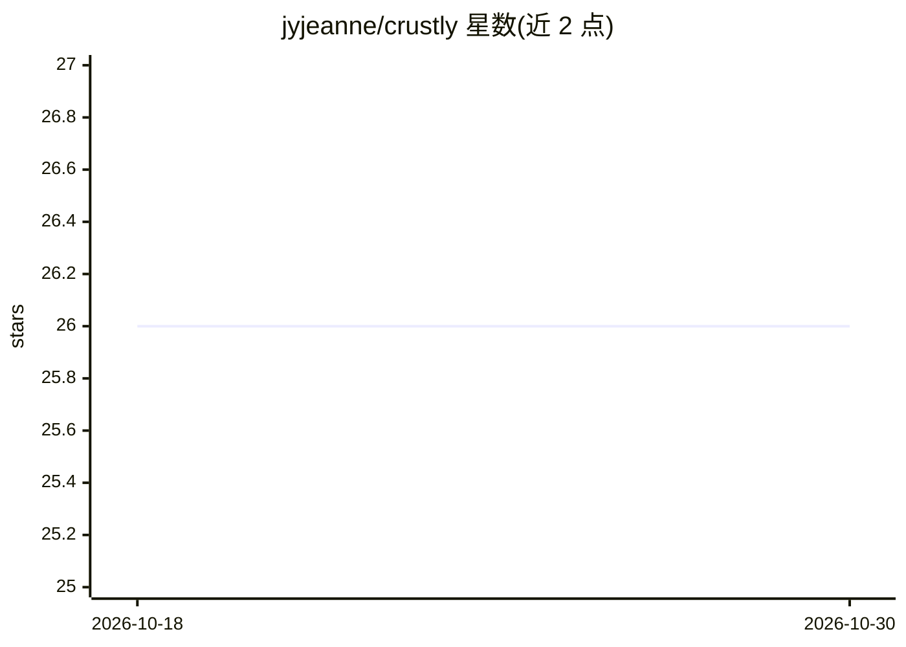

# jyjeanne/crustly

⭐ 26 · Rust · NOASSERTION · 推送 2026-10-26 · [GitHub](https://github.com/jyjeanne/crustly) · [官网](https://crates.io/crates/crustly) · 个人维护

**终端 AI 编程助手：Rust 实现，支持本地 LLM 离线运行**

Rust 编写的终端 AI 编程助手，是 Crush 的重实现（自称 95%+ 功能对齐）。面向在终端中工作的开发者，提供 22 个内置工具（文件/shell/web/子代理/技能）、交互式危险操作审批、会话记忆与压缩、子代理（explorer/implementer/reviewer）、多轮 /review 与 /spec 规格驱动开发命令。本地推理有三条路径：OpenAI 兼容接口、原生 Ollama、以及进程内 llama.cpp（加载 .gguf，支持 GPU 后端特性与语法约束工具调用），并提供 GGUF 模型管理（下载、硬件适配标注 Fits/Tight/Won't fit）。需从源码用 cargo 构建。

## 筛选速览

| 维度 | 判定 | 备注 |
|---|---|---|
| AI 角色 | `ai-native` | 本体是模型或模型工具 |
| 许可风险 | `none` | NOASSERTION |
| 部署形态 | `desktop` | 安装包/桌面程序 |
| 模型依赖 | local-ok | 支持本地模型 |
| 硬件要求 | — | 无带数字的原话,不猜 |
| 安装摩擦 | `high` | 编译与系统依赖俱全 |
| 成熟度 | `idea` | |

## 能力要点

- 22 个内置工具与交互式危险操作审批
- 三种本地推理路径：OpenAI 兼容接口、原生 Ollama、进程内 llama.cpp 加载 .gguf
- 为小上下文（8,192 token）重做的代理循环：压缩、轮次/时间/token 限制、验证后作答
- GGUF 模型管理：Ctrl+G 对话框、hf: 下载、GPU/RAM 适配检测

## 适用场景

- 在终端中让 AI 读改代码、跑命令、修复 bug
- 敏感代码使用本地 LLM 离线处理，不联网
- 用 /review 对 diff 或 PR 做多轮自动化代码审查
- 小内存本地模型上执行长任务（压缩与子代理分工）

## 场景标签

`编码 Agent` `代码审查` · 领域:编码与开发

## 证据(README 行号)

> L3:  Crustly — AI coding assistant, built with Rust
> L50: |🔧 **Built-in Tools**|22 tools: files, shell, web, agents, skills|Direct code manipulation from chat|
> L53: |🏠 **Local LLM Support**|Run with LM Studio, Ollama or in-process llama.cpp; fits an 8K context window|100% private

## 星数曲线

2026-10-18 26 → 2026-10-30 26（+0）

---
*卡片 v1 · prompt 1.4 · 生成 2026-10-26 · 置信度 mid · 依据 README sha `29aab140739f` · [字段定义](../../DATASET.md)*
