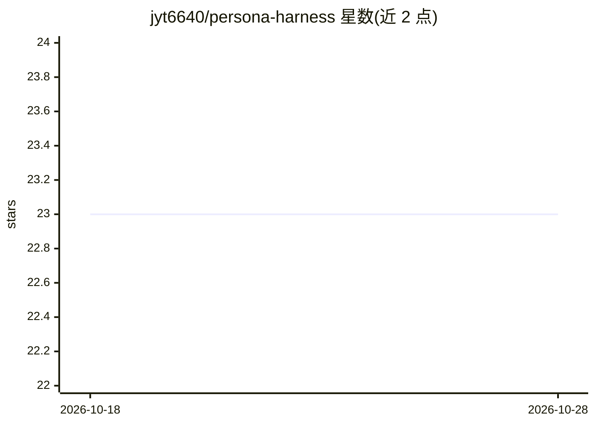

# jyt6640/persona-harness

⭐ 23 · TypeScript · Apache-2.0 · 推送 2026-10-09 · [GitHub](https://github.com/jyt6640/persona-harness) · 个人维护 · 中文 README

**约束 AI 编程代理完成度的证据门控 CLI 工作流**

面向 Java/Spring/Gradle 后端项目的 npm CLI（`ph`），用于约束 AI 编程代理的工作流与完成声明：把项目想法转为实现票据、通过有界命令运行验证、记录读了什么/跑了什么/完成了什么的本地证据，并在所需报告或证据缺失时阻断 `finish` 完成。为 Codex、Claude Code、OpenCode、Antigravity 安装可移植技能适配器。README 公布实测结果（含负结果），并声明多处能力边界；Context 个性化路径为实验性且默认关闭。

## 筛选速览

| 维度 | 判定 | 备注 |
|---|---|---|
| AI 角色 | `ai-ecosystem` | LLM/agent 周边工具 |
| 许可风险 | `permissive` | Apache-2.0 |
| 部署形态 | `library` | 以包/库形式分发 |
| 模型依赖 | — | README 未给出锁定关系 |
| 硬件要求 | — | 无带数字的原话,不猜 |
| 安装摩擦 | `medium` | 含编译或系统依赖之一 |
| 成熟度 | `idea` | |

## 能力要点

- 证据门控：缺失报告/证据时 `finish` 退出非零，实测伪造 TDD 证据被忽略
- 实测数据公开，包括负结果（运行时注入默认关闭）
- `ph init` 为 Codex/Claude Code/OpenCode/Antigravity 生成项目本地技能适配器
- 把项目想法/README 转为实现票据并维持可重复的后端工作流

## 适用场景

- 阻止 AI 代理无证据就声称任务完成
- 在 Java/Spring 项目上给编码代理加可重复的工作流轨道
- 在多个编码代理宿主间共享项目约定与技能

## 场景标签

`工作流自动化` · 领域:效率与自动化

## 证据(README 行号)

> L87: A workflow + evidence CLI (`ph`) with an optional OpenCode plugin, for Java/Spring backend work done by AI agents. 
> L117: - **Host:** `ph init` installs static skill adapters for Codex, Claude Code,

## 星数曲线

2026-10-18 23 → 2026-10-28 23（+0）

---
*卡片 v1 · prompt 1.4 · 生成 2026-10-27 · 置信度 high · 依据 README sha `3ba26692015b` · [字段定义](../../DATASET.md)*
