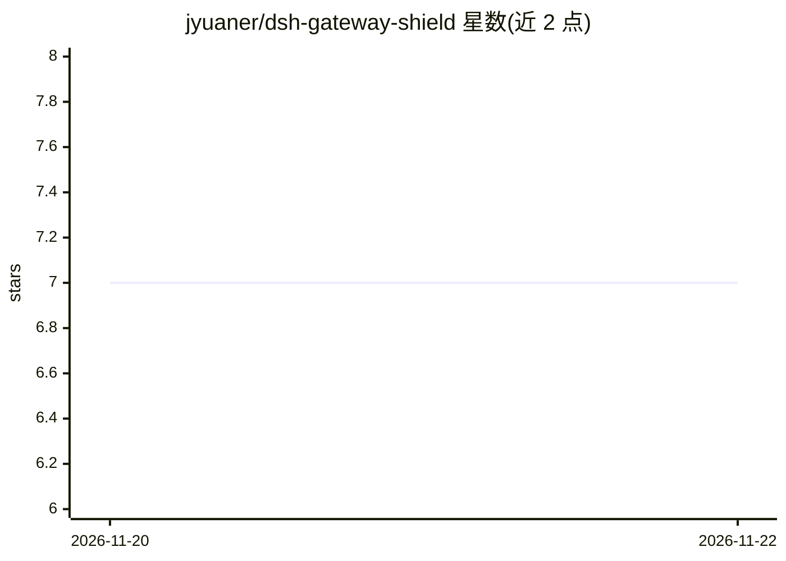

# jyuaner/dsh-gateway-shield

⭐ 7 · JavaScript · MIT · 推送 2026-11-19 · [GitHub](https://github.com/jyuaner/dsh-gateway-shield) · 个人维护 · 中文 README

**DSH 出网前清洗网关指纹提示词并做软拒绝重试的插件**

挂载在 DSH 的 `llm/stream` 钩子上、provider 无关的传输层插件：出网前对 system/messages/tools/toolHistory 四个面按指纹做同义改写，避免请求被网关内容匹配拦截（业务码 11128）；出网后检测模型软拒绝并带加固段重发（通过 `this.stream()` 重入而非失效的 `next(opts)`）。按 provider 前缀分档应用清洗规则，未识别的走通用层；零依赖、零网络。安装时默认顺带装行为层搭档 dsh-purge，连接器 WorkBuddy/Qoder 需手动选择安装且要求 Node ≥ 22.19。

## 筛选速览

| 维度 | 判定 | 备注 |
|---|---|---|
| AI 角色 | `ai-ecosystem` | LLM/agent 周边工具 |
| 许可风险 | `permissive` | MIT |
| 部署形态 | `library` | 以包/库形式分发 |
| 模型依赖 | — | README 未给出锁定关系 |
| 硬件要求 | — | 无带数字的原话,不猜 |
| 安装摩擦 | `low` | 无编译、无系统依赖或容器化 |
| 成熟度 | — | 结构信号不足 |

## 能力要点

- provider 无关，挂一次对所有模型生效，按前缀分档清洗规则
- 清洗四个面：system / messages / tools / toolHistory，幂等改写
- 软拒绝检测带加固重试，覆盖三种 system 提示形状
- armor/ 整合入口先体检再落文件，全程不调用包管理器

## 适用场景

- 使用 WorkBuddy/Qoder 等网关型模型时请求被 400/11128 渠道校验拦截
- 模型反复软拒绝、需要带加固段拉回一次
- 已有 dsh-purge 但换网关模型仍被挡的排查与修复

## 场景标签

 · 领域:LLM 基础设施/网关中间件

## 证据(README 行号)

> L13: 提示词组装之后、provider 适配器里面。这个插件就挂在那儿：`llm/stream`，provider 无关，
> L44: 所以**本插件对所有 provider 生效**，不需要为每个模型单独写适配。真正决定效果的是

## 星数曲线

2026-11-20 7 → 2026-11-22 7（+0）

---
*卡片 v1 · prompt 1.4 · 生成 2026-11-20 · 置信度 mid · 依据 README sha `83347c574434` · [字段定义](../../DATASET.md)*
