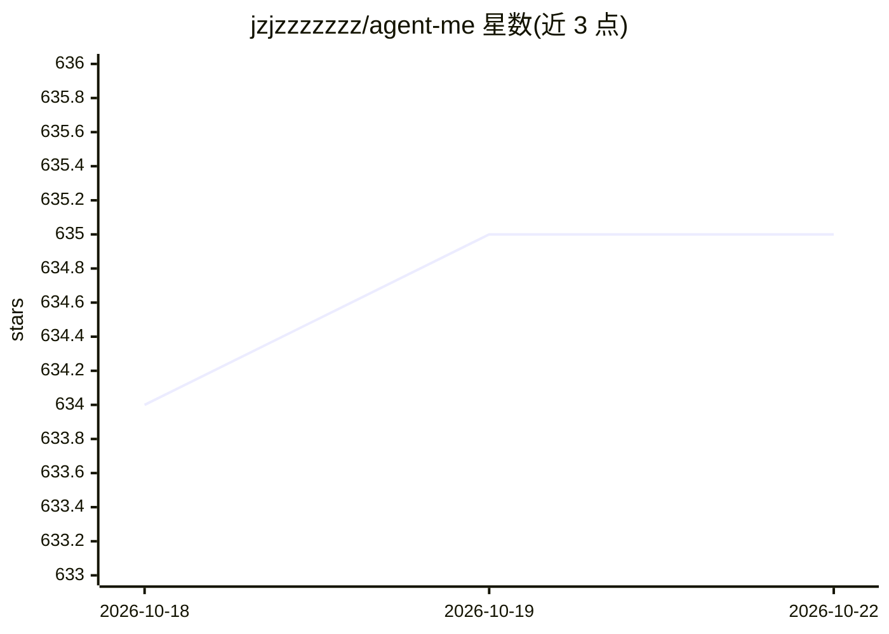

# jzjzzzzzzz/agent-me

⭐ 586 · Python · MIT · 推送 2026-10-21 · [GitHub](https://github.com/jzjzzzzzzz/agent-me) · [官网](https://jz-ai-chat.com) · 个人维护 · 中文 README

**把个人知识蒸馏为可检查的 AI 数字孪生系统**

开源的个人 AI Agent Twin 框架：以版本化 Markdown 作为可审查记忆基底，经确定性检索、Planner/Researcher/Critic/Writer/Verifier 多角色顺序协作产出带证据引用的回答，证据不足时拒绝合成。提供 FastAPI + React 实现，公开执行 trace 与确定性评测用例。默认本地模式无需 API key，可选接入 OpenAI 兼容 provider。附双语工程课程。当前为实验性、刻意受限的早期实现；外部工具集成与无约束语义推断属未来工作。

## 筛选速览

| 维度 | 判定 | 备注 |
|---|---|---|
| AI 角色 | `ai-ecosystem` | LLM/agent 周边工具 |
| 许可风险 | `permissive` | MIT |
| 部署形态 | `self-host` | docker 或自建部署 |
| 模型依赖 | — | README 未给出锁定关系 |
| 硬件要求 | — | 无带数字的原话,不猜 |
| 安装摩擦 | `low` | 无编译、无系统依赖或容器化 |
| 成熟度 | `idea` | |

## 能力要点

- 版本化 Markdown 记忆基底 + 浏览器审查工作台（私有工作区含 SQLite 类型化记忆、修订历史）
- Planner→Researcher→Critic→Writer(→Verifier) 五阶段流水线，类型化 Python 契约
- 证据不足时 Critic 阻断合成，返回固定 insufficient-evidence 响应
- 公开执行 trace 与版本化确定性评测（make test / make evaluate）

## 适用场景

- 把我的知识、偏好与决策记录构建成一个可检查的个人 AI 代表
- 研究可审查记忆、证据溯源与多智能体验证架构
- 按双语课程逐步重建该系统学习工程实现

## 场景标签

`多智能体` `RAG` `Agent 记忆` · 领域:Agent 开发

## 证据(README 行号)

> L73: Planner, Researcher, Critic, Writer, and optional Verifier roles have separate responsibilities and communicate thr

## 星数曲线

2026-10-18 634 → 2026-10-22 635（+1）

---
*卡片 v1 · prompt 1.4 · 生成 2026-10-21 · 置信度 high · 依据 README sha `5ff6bf7de5d8` · [字段定义](../../DATASET.md)*
