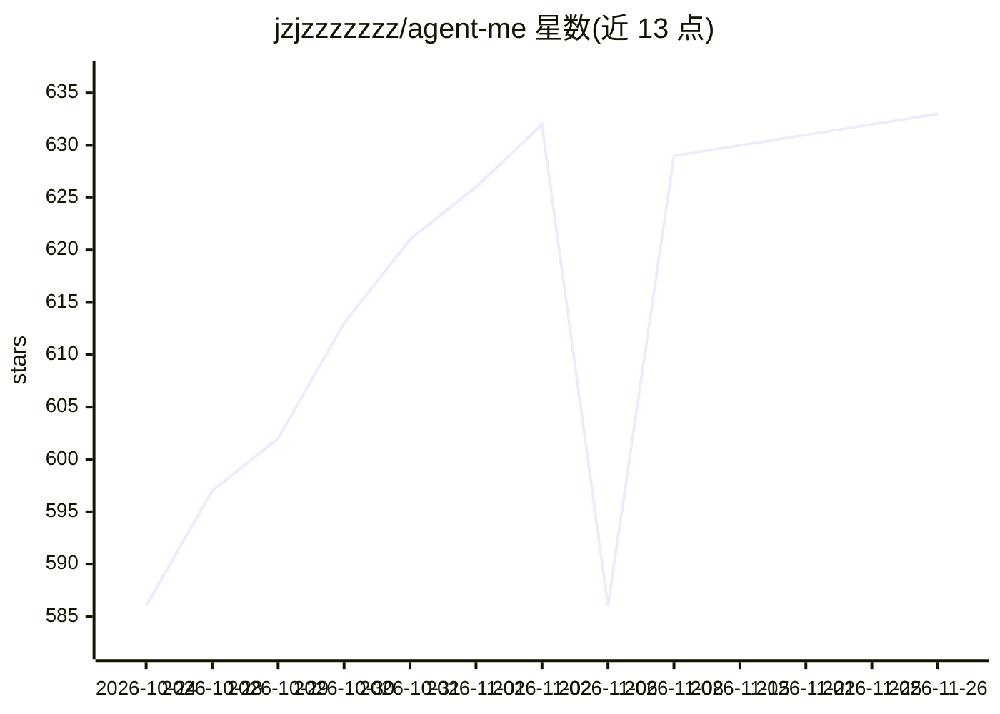

# jzjzzzzzzz/agent-me

⭐ 633 · Python · MIT · 推送 2026-11-23 · [GitHub](https://github.com/jzjzzzzzzz/agent-me) · [官网](https://jz-ai-chat.com) · 个人维护 · 中文 README

**将个人知识构建为可审查的 AI Agent Twin 的框架**

把个人知识、记忆与偏好蒸馏为一个开源、可审查的 AI Agent Twin：以版本控制的 Markdown 作为记忆底座，采用确定性本地检索与 Planner/Researcher/Critic/Writer/Verifier 多角色顺序管线，回答基于精确源文摘录并在证据不足时拒绝合成，全程暴露可审查执行轨迹与确定性评测。提供 FastAPI + React 可运行实现，默认本地抽取模式无需 API key，附双语工程课程。面向希望构建个人数字分身的开发者。

## 筛选速览

| 维度 | 判定 | 备注 |
|---|---|---|
| AI 角色 | `ai-native` | 本体是模型或模型工具 |
| 许可风险 | `permissive` | MIT |
| 部署形态 | `self-host` | docker 或自建部署 |
| 模型依赖 | — | README 未给出锁定关系 |
| 硬件要求 | — | 无带数字的原话,不猜 |
| 安装摩擦 | `low` | 无编译、无系统依赖或容器化 |
| 成熟度 | `idea` | |

## 能力要点

- Markdown 版本化记忆 + 确定性本地检索，默认模式无需 API key
- Planner/Researcher/Critic/Writer/Verifier 五角色顺序管线，typed Python 契约
- 证据不足时拒绝合成，验证引用路径与输出不变量
- 公开执行轨迹与版本化确定性评测 fixtures

## 适用场景

- 构建可审查的个人知识问答分身
- 学习检索-证据-多角色编排-验证的完整架构
- 为个人知识库实现带引用与评测的行为约束

## 场景标签

`多智能体` `RAG` `模型评测` `Agent 记忆` · 领域:Agent 开发

## 证据(README 行号)

> L48: Today, the repository provides a runnable FastAPI + React implementation over reviewable Markdown knowledge, with d
> L73: Planner, Researcher, Critic, Writer, and optional Verifier roles have separate responsibilities and communicate thr

## 星数曲线

2026-10-24 586 → 2026-11-26 633（+47）

---
*卡片 v1 · prompt 1.4 · 生成 2026-11-25 · 置信度 high · 依据 README sha `d9c4039f03e8` · [字段定义](../../DATASET.md)*
