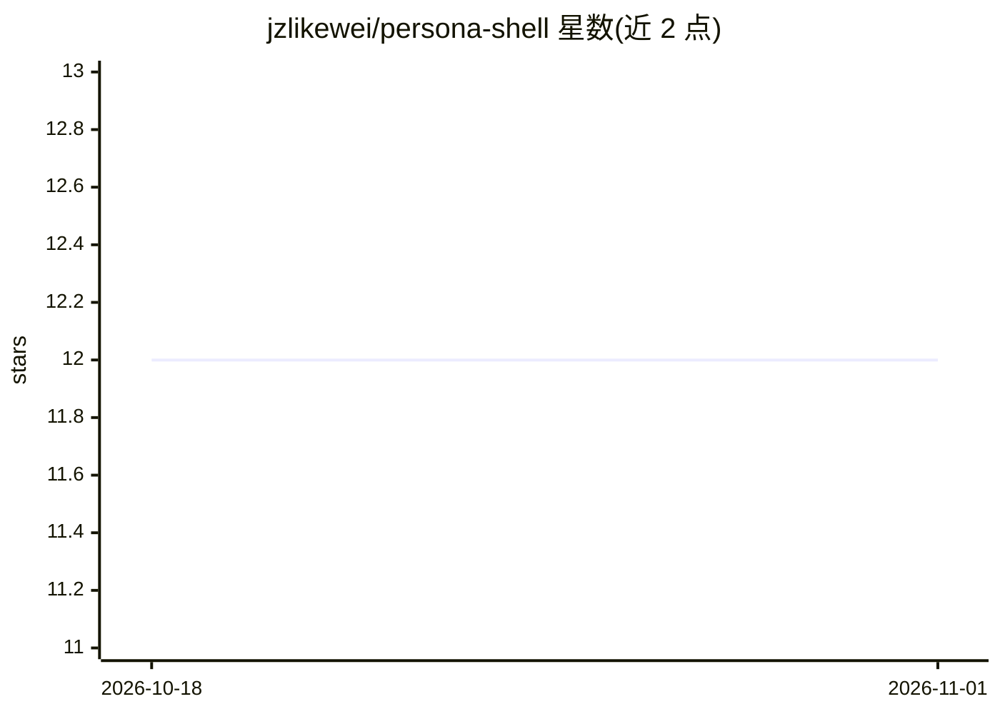

# jzlikewei/persona-shell

⭐ 12 · TypeScript · MIT · 推送 2026-09-29 · [GitHub](https://github.com/jzlikewei/persona-shell) · 个人维护 · 中文 README

**个人 AI 分身运行外壳：给 Claude Code/Codex 加身份、记忆与消息接入**

用 TypeScript/Bun 编写的 agent 外壳，围绕 Claude Code、Codex App Server 等强 agent 后端构建：通过飞书 IM 与 Web 工作台对话，按 workspace/session 组织上下文，`soul.md`、`personas/` 维护人格，Director 派发后台任务，Cron 定时触发，产物进入 outbox 并支持回调。数据存于本地文件系统由 git 管理，同一套人格可切换不同后端。主要开发环境为 macOS Apple Silicon，Windows 无支持计划；以高权限模式运行本地 agent。

## 筛选速览

| 维度 | 判定 | 备注 |
|---|---|---|
| AI 角色 | `ai-ecosystem` | LLM/agent 周边工具 |
| 许可风险 | `permissive` | MIT |
| 部署形态 | `None` |  |
| 模型依赖 | locked-api |  |
| 硬件要求 | — | 无带数字的原话,不猜 |
| 安装摩擦 | `low` | 无编译、无系统依赖或容器化 |
| 成熟度 | — | 结构信号不足 |

## 能力要点

- 飞书群聊/私聊映射到独立 workspace 的 IM 分身
- 多 Agent 后端可切换（Claude Code 默认、Codex App Server）
- 后台任务派发、Cron 定时触发与 outbox 产物追溯
- 人格、记忆、配置均在本地文件系统并由 git 管理

## 适用场景

- 通过飞书与自己的 AI 分身长期对话协作
- 跨项目维护个人 agent 的身份与上下文记忆
- 让 agent 在后台执行调研、写作、审查并接收回调结果

## 场景标签

 · 领域:AI Agent 基础设施/个人工作流

## 证据(README 行号)

> L7: Persona Shell 是一个给个人 AI 分身使用的运行外壳。Claude Code、Codex 负责推理、写代码和操作系统；Persona Shell 负责把它们接进你的真实工作生活：接消息、维护身份、记住现场、派发后台任务
> L35: - **多 Agent 后端**：同一套人格与记忆可运行在 Claude Code、Codex App Server 等后端上。
> L40: 不重新造轮子，只找最好的轮子装在你的车上。强 agent 已经存在，Persona Shell 把精力放在 agent 外围的部分：身份、上下文、路由、任务生命周期、交付物、长期可维护的记忆结构。

## 星数曲线

2026-10-18 12 → 2026-11-01 12（+0）

---
*卡片 v1 · prompt 1.4 · 生成 2026-11-01 · 置信度 high · 依据 README sha `7ec930873361` · [字段定义](../../DATASET.md)*
