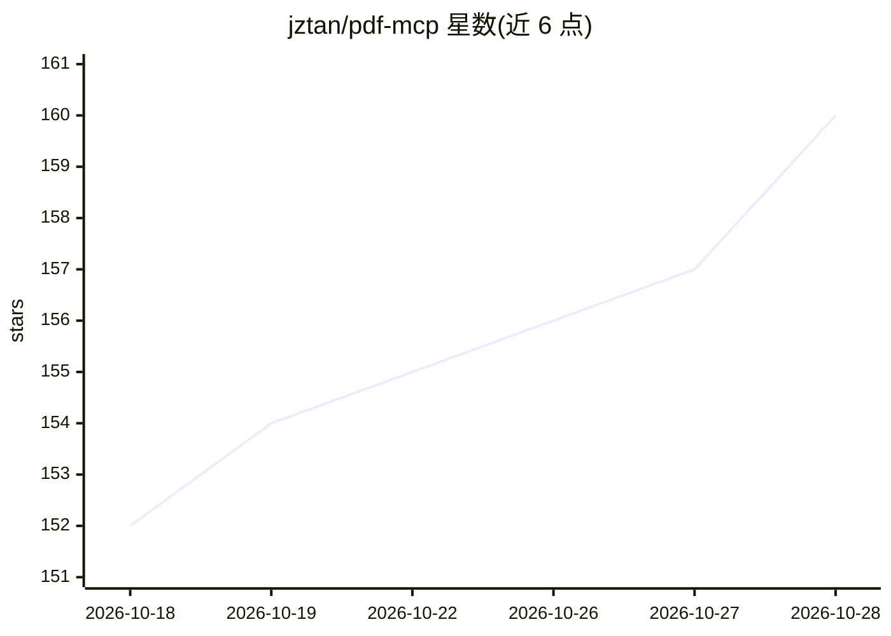

# jztan/pdf-mcp

⭐ 161 · Python · MIT · 推送 2026-10-28 · [GitHub](https://github.com/jztan/pdf-mcp) · [官网](https://pdf-mcp.jztan.com) · 个人维护

**让 AI agent 检索与阅读大型 PDF 的 MCP 服务器**

面向 Claude Code 等 MCP 客户端的 PDF 检索服务器：单个文件或整个文件夹均可，提供 13 个工具，核心模式为先 pdf_info 规划、pdf_search 混合检索（BM25 + 语义）、按需读取页面，支持表格、图表数据提取、OCR（Tesseract）、多栏与日文竖排布局，SQLite 缓存跨重启保留。也可作为普通 Python 函数导入或经 HTTP 传输部署，GHCR 提供 Docker 镜像。Python 3.10+，MIT 许可，OCR 与 CUDA 加速为可选组件。

## 筛选速览

| 维度 | 判定 | 备注 |
|---|---|---|
| AI 角色 | `ai-ecosystem` | LLM/agent 周边工具 |
| 许可风险 | `permissive` | MIT |
| 部署形态 | `library` | 以包/库形式分发 |
| 模型依赖 | — | README 未给出锁定关系 |
| 硬件要求 | — | 无带数字的原话,不猜 |
| 安装摩擦 | `medium` | 含编译或系统依赖之一 |
| 成熟度 | — | 结构信号不足 |

## 能力要点

- 13 个工具：规划/混合检索/按页读取/语料库分诊与跨文档检索
- BM25 关键词 + 语义混合搜索，SQLite 缓存跨重启保留
- 表格结构化提取与矢量图表 (x, y) 数据读取
- 多栏与日文竖排（tategaki）阅读顺序修正，Tesseract OCR

## 适用场景

- 让 Claude Code 等 agent 只读取 PDF 中相关页面，节省 token
- 把整个 PDF 文件夹当作 agent 知识库做跨文档检索
- 处理扫描件、多栏排版与日文竖排 PDF 的提取

## 场景标签

`RAG` `语义搜索` `OCR` `文档解析` · 领域:知识与检索

## 证据(README 行号)

> L13: The agent decides when to search; pdf-mcp does the retrieval and hands back excerpts. It is an MCP server that lets
> L100: ## Tools
> L154: STDIO is the default and is what every example above uses. `pdf-mcp-http`

## 星数曲线

2026-10-18 152 → 2026-10-28 160（+8）

---
*卡片 v1 · prompt 1.4 · 生成 2026-10-22 · 置信度 high · 依据 README sha `87a53d7c067a` · [字段定义](../../DATASET.md)*
