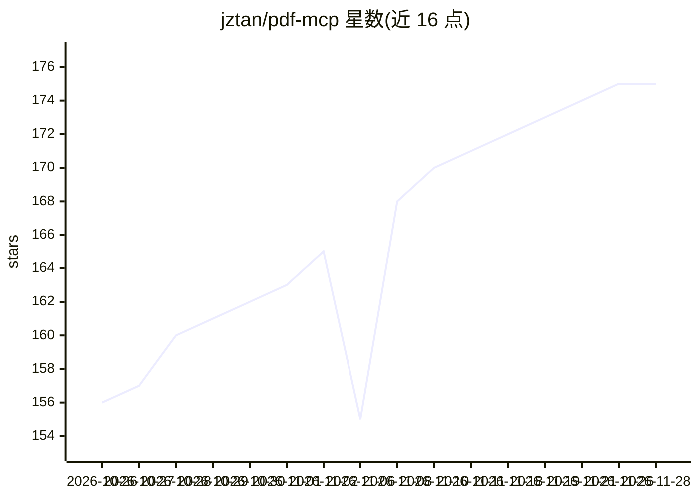

# jztan/pdf-mcp

⭐ 175 · Python · MIT · 推送 2026-11-23 · [GitHub](https://github.com/jztan/pdf-mcp) · [官网](https://pdf-mcp.jztan.com) · 个人维护

**让 AI agent 检索 PDF 并返回页级出处的 MCP 服务器**

一个面向 Claude Code 等 MCP 客户端的 PDF 检索服务器：agent 决定何时检索，pdf-mcp 提供混合搜索（BM25+语义）、按需读取指定页、表格与图表数据抽取、扫描页 OCR（Tesseract）以及多栏与日文竖排的阅读顺序还原。每次返回附页码出处；隐藏文本（含注入指令）被标记为不可信。支持单 PDF 或整文件夹索引（SQLite 缓存），提供 13 个工具、浏览器演示、HTTP 传输与 GHCR Docker 镜像。需 Python 3.11–3.14，OCR 依赖 Tesseract。

## 筛选速览

| 维度 | 判定 | 备注 |
|---|---|---|
| AI 角色 | `ai-ecosystem` | LLM/agent 周边工具 |
| 许可风险 | `permissive` | MIT |
| 部署形态 | `library` | 以包/库形式分发 |
| 模型依赖 | — | README 未给出锁定关系 |
| 硬件要求 | — | 无带数字的原话,不猜 |
| 安装摩擦 | `low` | 无编译、无系统依赖或容器化 |
| 成熟度 | — | 结构信号不足 |

## 能力要点

- 13 个专用工具：pdf_info 计划、pdf_search 混合检索、pdf_read_pages 按页读取
- 混合检索（BM25 关键词+语义）与整文件夹 warm/triage/搜索，带文档与页级来源
- 隐藏文本与注入指令标记为不可信，可选渲染页面与实际印刷内容比对
- 矢量图表抽取为 (x,y) 数据，多栏与日文竖排阅读顺序处理

## 适用场景

- 让 agent 在大 PDF 中定位并只读需要的页，节省 token
- 把整个 PDF 文件夹作为 agent 知识库跨文档检索
- 从扫描件 OCR 取文、从矢量图表抽取数据
- 核验回答对应的原始页面证据

## 场景标签

`RAG` `文档解析` · 领域:知识与检索

## 证据(README 行号)

> L11: **Agentic RAG over your PDFs, with the evidence to check every answer.**
> L13: The agent decides when to search; pdf-mcp does the retrieval and hands back excerpts, each with the page it came fr
> L111: 13 specialized tools rather than one monolithic one. Typical pattern:

## 星数曲线

2026-10-26 156 → 2026-11-28 175（+19）

---
*卡片 v1 · prompt 1.4 · 生成 2026-11-27 · 置信度 high · 依据 README sha `ed5c0a0080c0` · [字段定义](../../DATASET.md)*
