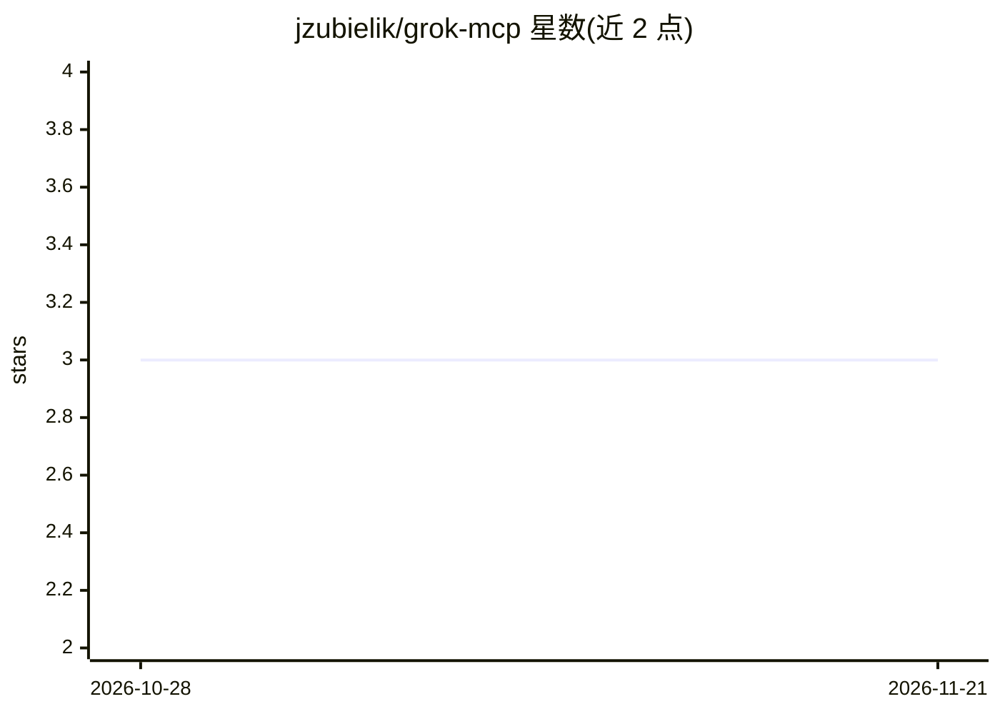

# jzubielik/grok-mcp

⭐ 3 · Python · MIT · 推送 2026-11-17 · [GitHub](https://github.com/jzubielik/grok-mcp) · 个人维护

**将 xAI Grok API 接入任意 MCP 客户端的服务器**

面向 MCP 客户端的 xAI Grok API 封装服务器，提供带工作区工具循环（read/write/shell/fetch/search）的 agent 工具、视觉输入、图像生成、语音合成与转录。强制依赖 xAI API key 与 PostgreSQL（会话历史与后台任务），支持 Docker Compose（HTTP）与 stdio 两种运行方式。带成本/时间/迭代预算控制、后台任务心跳、对话历史归档，并通过路径允许列表与配置外置约束 agent 的文件访问边界。

## 筛选速览

| 维度 | 判定 | 备注 |
|---|---|---|
| AI 角色 | `ai-ecosystem` | LLM/agent 周边工具 |
| 许可风险 | `permissive` | MIT |
| 部署形态 | `self-host` | docker 或自建部署 |
| 模型依赖 | locked-api |  |
| 硬件要求 | — | 无带数字的原话,不猜 |
| 安装摩擦 | `low` | 无编译、无系统依赖或容器化 |
| 成熟度 | — | 结构信号不足 |

## 能力要点

- agent 工具支持 read/write/shell/fetch/search 工具循环，可后台运行并有心跳保活
- 每次调用需指定 model，工具描述在启动时从 xAI live API 拉取模型目录与价格
- 多级预算控制：max_iterations、max_seconds、max_cost_usd、上下文占比限制
- 预构建镜像发布于 GitHub Container Registry，附 SBOM 与签名构建证明

## 适用场景

- 在 Claude Code 等支持 MCP 的客户端中调用 Grok 完成带工作区操作的 agent 任务
- 通过 MCP 工具生成图像、语音或转录音频文件
- 多个客户端会话共享同一 PostgreSQL 实现会话历史与后台任务互通

## 场景标签

`图像生成` `语音合成` `语音识别` · 领域:内容生成

## 证据(README 行号)

> L3: An MCP server for the xAI Grok API, usable from any MCP client: chat and reasoning with an
> L7: > Independent project — not affiliated with or endorsed by xAI. "Grok" is a trademark of xAI.

## 星数曲线

2026-10-28 3 → 2026-11-21 3（+0）

---
*卡片 v1 · prompt 1.4 · 生成 2026-11-21 · 置信度 mid · 依据 README sha `093189a55cfd` · [字段定义](../../DATASET.md)*
