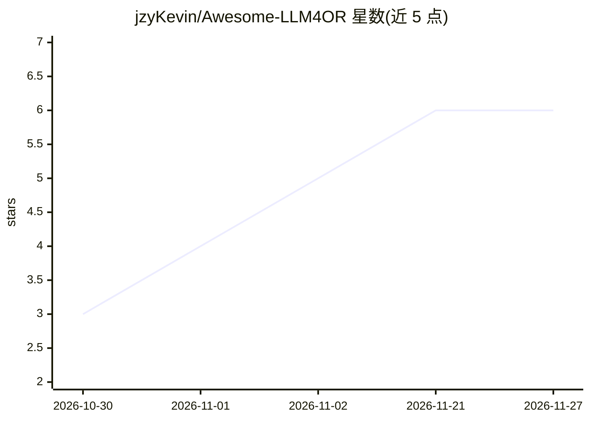

# jzyKevin/Awesome-LLM4OR

⭐ 6 · 推送 2026-11-07 · [GitHub](https://github.com/jzyKevin/Awesome-LLM4OR) · 个人维护 · 中文 README

**运筹优化领域 LLM 研究的论文与资源策展清单**

面向运筹学与优化研究者的文献聚合仓库：收录 258 篇论文，按综述、入门路径、研究方法（优化建模与代码生成等）、基准与数据集、开放资源等板块组织，条目含年份/发表处、贡献摘要与 arXiv/DOI/代码/数据链接。提供按阅读目标（综述、任务评测、求解生成、自动算法设计、求解器配置）排列的入门路线表，双语说明，标注更新日期。

## 筛选速览

| 维度 | 判定 | 备注 |
|---|---|---|
| AI 角色 | `ai-knowledge` | 知识聚合/清单类 |
| 许可风险 | `none` | — |
| 部署形态 | `None` |  |
| 模型依赖 | — | README 未给出锁定关系 |
| 硬件要求 | — | 无带数字的原话,不猜 |
| 安装摩擦 | `low` | 无编译、无系统依赖或容器化 |
| 成熟度 | — | 结构信号不足 |

## 能力要点

- 收录 258 篇 LLM×运筹优化论文并标注更新日期
- 按研究目标组织的分类目录与入门阅读路线表
- 条目附贡献摘要、技术标签及 arXiv/DOI/代码/数据链接
- 提供简体中文与英文双语说明

## 适用场景

- 入门 LLM 在运筹优化领域的文献检索
- 查找优化建模、调度、组合优化的基准与数据集
- 调研 LLM 用于算法设计与自动建模的研究进展

## 场景标签

`精选清单` · 领域:学习与行业

## 证据(README 行号)

> L7: A curated collection of papers, benchmarks, datasets, models, and tools for **Large Language Models for Operations R
> L13: ## Contents
> L17: Surveys, systematic reviews, tutorials, and research frameworks.

## 星数曲线

2026-10-30 3 → 2026-11-27 6（+3）

---
*卡片 v1 · prompt 1.4 · 生成 2026-11-21 · 置信度 high · 依据 README sha `97b3686507e5` · [字段定义](../../DATASET.md)*
