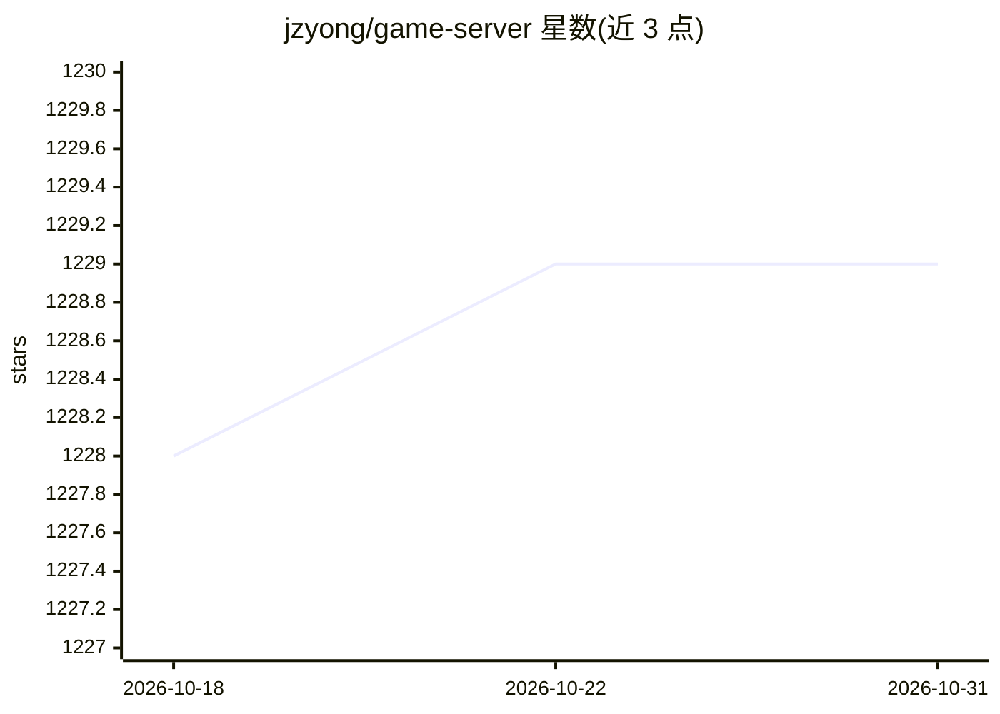

# jzyong/game-server

⭐ 1,229 · Java · MIT · 推送 2025-12-19 · [GitHub](https://github.com/jzyong/game-server) · [官网](https://jzyong.github.io/game-server/) · 个人维护 · 中文 README

**棋牌/MMORPG 游戏的分布式 Java 服务器框架**

基于 Java 的分布式游戏服务器框架，包含集群注册中心、网关（MINA 封装 TCP/UDP/WebSocket/HTTP）、登录、大厅、游戏逻辑服与后台监控服务器，理论上支持网关服、大厅服与游戏服水平扩展。封装了 Redis 集群、MongoDB、消息队列、线程模型与导表工具；提供状态机、行为树、A* 寻路、导航网格等游戏 AI 工具，并附带网页版捕鱼运行示例。README 声明项目已无新功能开发、仅维护，新版本可参考 GameServer4j，game-ai 已迁移至 GameAi4j。

## 筛选速览

| 维度 | 判定 | 备注 |
|---|---|---|
| AI 角色 | `ai-enhanced` | 去掉 AI 部分产品仍成立 |
| 许可风险 | `permissive` | MIT |
| 部署形态 | `None` |  |
| 模型依赖 | — | README 未给出锁定关系 |
| 硬件要求 | — | 无带数字的原话,不猜 |
| 安装摩擦 | `low` | 无编译、无系统依赖或容器化 |
| 成熟度 | — | 结构信号不足 |

## 能力要点

- 集群管理、网关、大厅、游戏逻辑、后台监控等多类服务器组件
- MINA 封装 TCP/UDP/WebSocket/HTTP 多协议客户端支持
- 封装 Redis 集群、MongoDB、消息队列、线程模型与导表工具
- 状态机、行为树、A* 寻路、导航网格等游戏 AI 工具

## 适用场景

- 搭建棋牌类或 MMORPG 游戏的分布式服务端
- 需要多协议（TCP/UDP/WebSocket/HTTP）客户端接入的游戏项目
- 参考网页版捕鱼示例了解服务器运行方式

## 场景标签

 · 领域:游戏服务端开发

## 证据(README 行号)

> L6: 一个基于棋牌、MMORPG游戏的分布式java游戏服务器，理论上可以无限水平扩展网关服，大厅服、游戏服达到人数承载。实现了集群注册中心，网关、登陆、后台服务器监控等通用服务器;封装了redis集群、mongodb等数据库处理；封装了
> L13: 项目已无新功能开发，只维护：

## 星数曲线

2026-10-18 1,228 → 2026-10-31 1,229（+1）

---
*卡片 v1 · prompt 1.4 · 生成 2026-10-21 · 置信度 mid · 依据 README sha `4e03995abc7b` · [字段定义](../../DATASET.md)*
