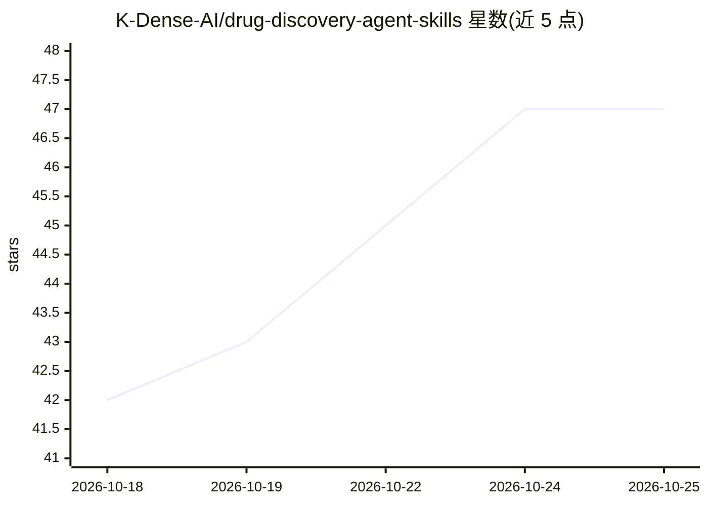

# K-Dense-AI/drug-discovery-agent-skills

⭐ 47 · Python · MIT · 推送 2026-10-19 · [GitHub](https://github.com/K-Dense-AI/drug-discovery-agent-skills) · [官网](www.k-dense.ai) · 组织维护

**药物研发 agent 技能包：37 个技能教编码代理使用计算化学与生物学工具**

面向小分子与蛋白疗法的 Agent Skills 集合：以 SKILL.md 形式提供 37 个技能，教 Claude Code、Cursor、Codex 等编码代理如何安装和使用计算化学与生物学工具——覆盖靶点发现与知识图谱、化学信息学、分子机器学习、对接与动力学、抗体与蛋白设计、ADMET 与临床监管检索等类别。技能以 Agent Plugins 1.0.0 包形式整体安装，代理按任务按需加载。注意：安装的是指令而非软件包，各工具环境在首次使用时由代理搭建，部分技能需 GPU、API key 或特定 Python 版本。

## 筛选速览

| 维度 | 判定 | 备注 |
|---|---|---|
| AI 角色 | `ai-knowledge` | 知识聚合/清单类 |
| 许可风险 | `permissive` | MIT |
| 部署形态 | `library` | 以包/库形式分发 |
| 模型依赖 | — | README 未给出锁定关系 |
| 硬件要求 | — | 无带数字的原话,不猜 |
| 安装摩擦 | `low` | 无编译、无系统依赖或容器化 |
| 成熟度 | — | 结构信号不足 |

## 能力要点

- 37 个技能组成可交叉引用的整体包（Agent Plugins 1.0.0 标准格式）
- 覆盖靶点验证到临床试验检索的完整药物研发工作流
- 每个技能标注资源需求：local / network no key / key / GPU / Python 版本限制
- 技能组合编排：单个请求通常串联 2-3 个技能完成端到端任务

## 适用场景

- 让我的编码代理完成从疾病到靶点再到分子设计的药物研发流程
- 给 Claude Code / Cursor 等代理挂载化学信息学与对接仿真能力
- 查询 ChEMBL、DepMap、ClinicalTrials.gov 等数据库支撑研发决策

## 场景标签

`编码 Agent` · 领域:编码与开发

## 证据(README 行号)

> L16: Thirty-seven skills that teach your coding agent the tools computational chemists and biologists
> L22: Every skill follows the open Agent Skills standard, and the

## 星数曲线

2026-10-18 42 → 2026-10-25 47（+5）

---
*卡片 v1 · prompt 1.4 · 生成 2026-10-25 · 置信度 mid · 依据 README sha `b843a54e8394` · [字段定义](../../DATASET.md)*
