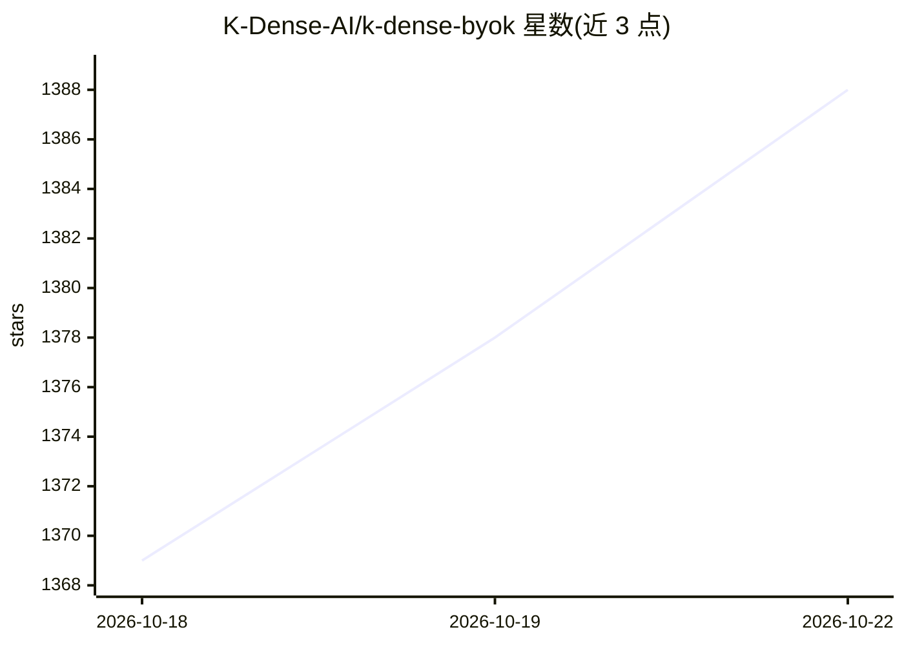

# K-Dense-AI/k-dense-byok

⭐ 1,388 · TypeScript · MIT · 推送 2026-10-16 · [GitHub](https://github.com/K-Dense-AI/k-dense-byok) · [官网](https://arxiv.org/abs/2610.00074) · 组织维护

**本地运行的科研 AI 助手（BYOK），带可追溯实验记录**

开源桌面应用 K-Dense BYOK（助手名 Kady），面向各领域科研人员：用自然语言下达任务，Kady 在项目工作区内读写文件、编写并运行分析代码、检索文献、生成图表与报告。模型接入采用 BYOK 模式：可接 OpenRouter 预付费、多种订阅账号（ChatGPT/Copilot/xAI/Kimi/Meta Muse 等）或本地 Ollama 模型，费用按项目限额跟踪。内置 177 个科学技能、326 个工作流模板、229 个数据资源指引与 23 个专家委派机制；记录侧提供活页实验记录本、文件溯源、加密链冻结分析计划与并行验证轮。当前为 beta 版；订阅/托管模型用量受各自配额限制。

## 筛选速览

| 维度 | 判定 | 备注 |
|---|---|---|
| AI 角色 | `ai-native` | 本体是模型或模型工具 |
| 许可风险 | `permissive` | MIT |
| 部署形态 | `None` |  |
| 模型依赖 | local-ok | 支持本地模型 |
| 硬件要求 | — | 无带数字的原话,不猜 |
| 安装摩擦 | `low` | 无编译、无系统依赖或容器化 |
| 成熟度 | `idea` | |

## 能力要点

- BYOK 接入：OpenRouter 预付费、多家订阅账号或本地 Ollama 模型，按项目限额跟踪用量
- 177 个科学技能 + 326 个工作流模板 + 229 个数据资源 + 23 个可并行委派的专家
- 活页实验记录本、文件级溯源（Provenance）、密码学摘要链冻结的分析计划
- /prove-verify 多轮对抗验证与可选第二审查模型（watchdog）

## 适用场景

- 用自然语言完成数据清洗、统计与图表的端到端分析
- 检索并比对文献、审计稿件、核对具体论断的出处
- 在数据不出本机的前提下（本地 Ollama）运行 AI 科研助手
- 冻结分析计划并压力测试结论稳健性，留存可复现研究记录

## 场景标签

`AI 助手` `科研工具` `数据分析` · 领域:效率与自动化

## 证据(README 行号)

> L25: K-Dense BYOK (Bring Your Own Keys) is a free, open-source app that gives you **Kady** — an AI research assistant fo
> L31: - **Your workspace stays on your computer.** Projects, conversations, notebooks, and results live in ordinary folde

## 星数曲线

2026-10-18 1,369 → 2026-10-22 1,388（+19）

---
*卡片 v1 · prompt 1.4 · 生成 2026-10-21 · 置信度 high · 依据 README sha `85206cd48797` · [字段定义](../../DATASET.md)*
