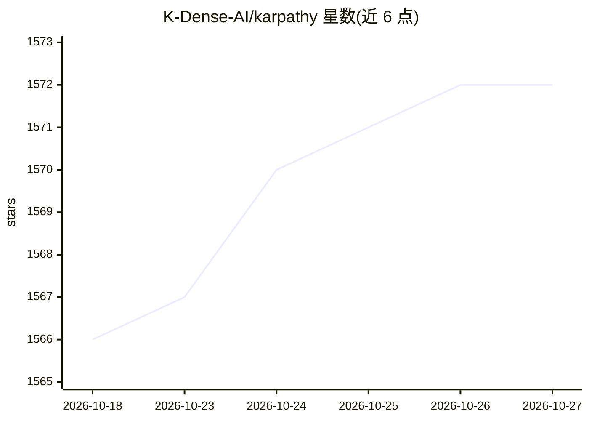

# K-Dense-AI/karpathy

⭐ 1,572 · Python · MIT · 推送 2026-08-18 · [GitHub](https://github.com/K-Dense-AI/karpathy) · [官网](https://k-dense.ai) · 组织维护

**基于 Claude Agent SDK 与 Google ADK 的代理式机器学习工程师**

K-Dense 维护的代理式 ML 工程师实现：通过 Claude Agent SDK 与 Google ADK 构建的 karpathy agent，在沙盒中借助 Scientific Agent Skills（130+ 研究技能）调用 PyTorch、transformers、scikit-learn 等 ML 库训练模型。start.py 自动创建沙盒、虚拟环境并启动 ADK Web 界面（localhost:8000）；需 Python 3.13+、uv、Claude Code 与 OpenRouter API key。声明与 Andrej Karpathy 无关联，名称仅为致敬；增强的多代理能力需注册其商业网站。

## 筛选速览

| 维度 | 判定 | 备注 |
|---|---|---|
| AI 角色 | `ai-native` | 本体是模型或模型工具 |
| 许可风险 | `permissive` | MIT |
| 部署形态 | `None` |  |
| 模型依赖 | locked-api |  |
| 硬件要求 | — | 无带数字的原话,不猜 |
| 安装摩擦 | `low` | 无编译、无系统依赖或容器化 |
| 成熟度 | — | 结构信号不足 |

## 能力要点

- 基于 Claude Agent SDK 与 Google ADK 的代理式 ML 训练 agent
- start.py 一键创建含 130+ Scientific Agent Skills 的沙盒与 ADK Web 界面
- 沙盒环境预装 PyTorch、transformers、scikit-learn 等 ML 包
- 通过 OpenRouter API key 接入模型

## 适用场景

- 让 AI agent 在沙盒中帮我训练机器学习模型
- 通过浏览器对话界面执行科研/ML 工作流
- 体验 Agent Skills 标准下的科研技能组合

## 场景标签

`编码 Agent` `科研工具` · 领域:编码与开发

## 证据(README 行号)

> L21: An agentic Machine Learning Engineer that trains state-of-the-art ML models using the Claude Agent SDK and Google A
> L64: python start.py
> L69: 2. Sets up a Python virtual environment with ML packages (PyTorch, transformers, scikit-learn, etc.)

## 星数曲线

2026-10-18 1,566 → 2026-10-27 1,572（+6）

---
*卡片 v1 · prompt 1.4 · 生成 2026-10-21 · 置信度 high · 依据 README sha `07093289b538` · [字段定义](../../DATASET.md)*
