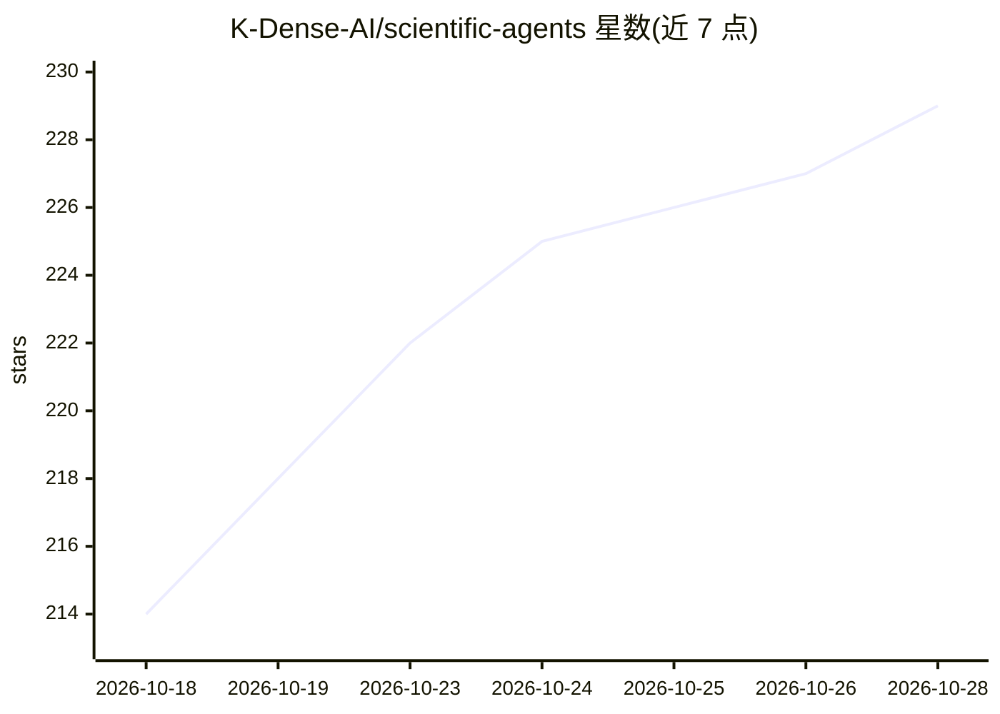

# K-Dense-AI/scientific-agents

⭐ 229 · Python · MIT · 推送 2026-10-02 · [GitHub](https://github.com/K-Dense-AI/scientific-agents) · [官网](https://arxiv.org/abs/2610.00084) · 组织维护

**科研/工程专家思维 AGENTS.md 提示词档案合集，供 AI agent 加载**

按职业（如天文学家、生物信息学家、临床流行病学家）收录专家思维提示词档案：每个 AGENTS.md 编码该领域资深从业者的问题框架、工具与数据源、失效模式与报告规范，作为 AI 编码 agent 的项目级上下文加载。档案按研究流程构建并要求领域具体性，索引于 catalog.json；同时打包为 Agent Plugins 规范的插件，可通过 GitHub Copilot、VS Code、Claude Code 插件市场或复制文件方式安装；Cursor、Codex、OpenCode、Pi 等工具原生读取 AGENTS.md。附 arXiv 论文并请求引用。

## 筛选速览

| 维度 | 判定 | 备注 |
|---|---|---|
| AI 角色 | `ai-knowledge` | 知识聚合/清单类 |
| 许可风险 | `permissive` | MIT |
| 部署形态 | `library` | 以包/库形式分发 |
| 模型依赖 | — | README 未给出锁定关系 |
| 硬件要求 | — | 无带数字的原话,不猜 |
| 安装摩擦 | `medium` | 含编译或系统依赖之一 |
| 成熟度 | — | 结构信号不足 |

## 能力要点

- 每个档案对应一个科学/工程职业的专家思维与工作流程
- 符合 Agent Plugins 1.0.0 规范，含 plugin.json 与 SKILL.md
- 提供 Copilot CLI / VS Code / Claude Code 插件市场安装途径
- AGENTS.md 为开放标准，同一文件可跨多种 AI 编码工具使用

## 适用场景

- 为我的 AI 编码助手加载所在领域的专家思维与研究规范
- 按职业查找可直接复用的系统提示词档案
- 通过 Claude Code 插件市场把某个专家档案装成子代理

## 场景标签

`提示工程` `科研工具` · 领域:Agent 开发

## 证据(README 行号)

> L33: This repository collects **expert-thinking profiles**: one `AGENTS.md` per scientific
> L71: Profiles are maintained in `scientific-agents/<profession>/AGENTS.md` and indexed in
> L93: Every profile folder is an official Agent Plugin — the

## 星数曲线

2026-10-18 214 → 2026-10-28 229（+15）

---
*卡片 v1 · prompt 1.4 · 生成 2026-10-22 · 置信度 mid · 依据 README sha `c11f82adefe1` · [字段定义](../../DATASET.md)*
