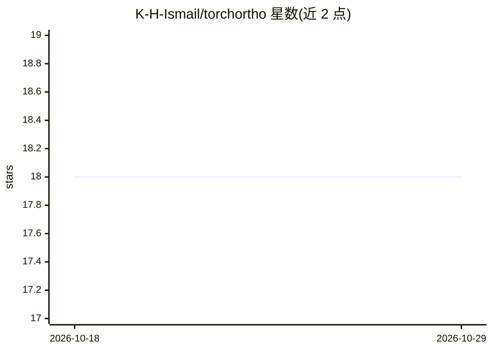

# K-H-Ismail/torchortho

⭐ 18 · Jupyter Notebook · GPL-3.0 · 推送 2026-02-23 · [GitHub](https://github.com/K-H-Ismail/torchortho) · [官网](https://arxiv.org/abs/2502.01247) · 个人维护

**PyTorch 可学习激活函数库：Hermite/Fourier/Tropical 基**

基于 ICLR 2026 论文《Polynomial, Trigonometric, and Tropical Activations》的 PyTorch 库，提供 Hermite 多项式、Fourier 级数、Tropical 多项式与有理函数四类可学习激活函数，训练中动态调整参数。用法与常规 PyTorch 激活一致，可直接嵌入 nn.Module 网络。README 报告了在 ImageNet-1K（ConvNeXt-T 替换 GELU）与 OpenWebText（GPT-2）上的基准实验，实验代码在独立仓库。GPL-3.0 许可。

## 筛选速览

| 维度 | 判定 | 备注 |
|---|---|---|
| AI 角色 | `ai-native` | 本体是模型或模型工具 |
| 许可风险 | `viral` | GPL-3.0 |
| 部署形态 | `library` | 以包/库形式分发 |
| 模型依赖 | — | README 未给出锁定关系 |
| 硬件要求 | — | 无带数字的原话,不猜 |
| 安装摩擦 | `low` | 无编译、无系统依赖或容器化 |
| 成熟度 | — | 结构信号不足 |

## 能力要点

- 四类可学习激活：Hermite、Fourier、Tropical 多项式、Rational
- API 与常规 PyTorch 激活一致，可直接嵌入网络
- 方差保持初始化用于训练稳定性
- 在 ConvNeXt/ImageNet 与 GPT-2/OpenWebText 上有基准实验

## 适用场景

- 在视觉或语言模型中替换 ReLU/GELU 进行实验
- 研究可学习激活对表达力与梯度流的影响
- 处理含周期结构的数据（NLP、物理、时序）时使用 Fourier 激活

## 场景标签

 · 领域:深度学习/神经网络组件

## 证据(README 行号)

> L8: `torchortho` is a **PyTorch library** for **learnable activation functions** based on:
> L16: This library is based on the paper:
> L72: ✅ **Image Classification (ConvNeXt-T on ImageNet-1K)**

## 星数曲线

2026-10-18 18 → 2026-10-29 18（+0）

---
*卡片 v1 · prompt 1.4 · 生成 2026-10-29 · 置信度 high · 依据 README sha `499bc1cf33bb` · [字段定义](../../DATASET.md)*
