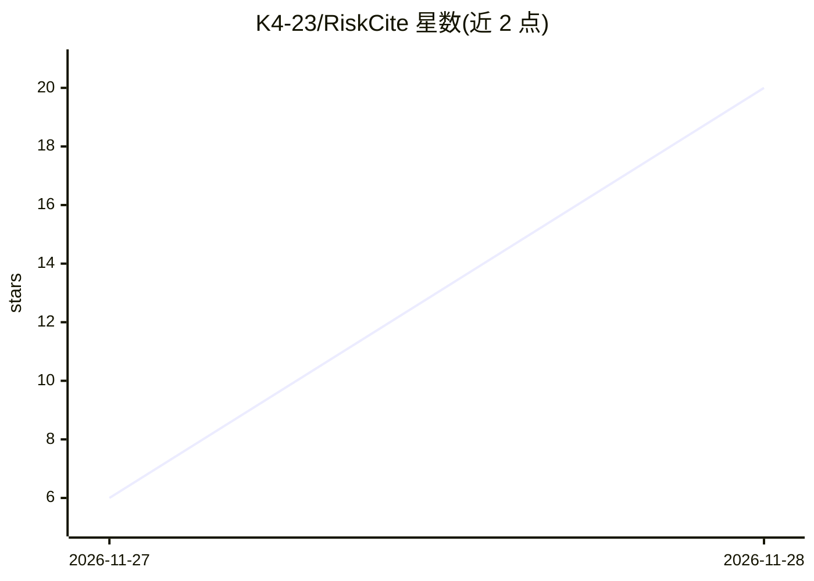

# K4-23/RiskCite

⭐ 20 · Python · Apache-2.0 · 推送 2026-11-20 · [GitHub](https://github.com/K4-23/RiskCite) · 个人维护 · 中文 README

**上传企业材料生成风险清单并给出原文与法条出处的 RAG 工具**

基于 RAG 的企业风险评估工具：用户上传企业材料，系统生成风险清单，每条结论附带材料原文出处与相关法条作为证据。内置法规与案例两个知识库，知识库需自行上传建立，docs 文件夹提供参考模板。后端为 Python（环境要求 Python 3.12+），前端为 Node 应用（Node 18+），通过 env 文件配置任意 OpenAI 兼容接口的模型，嵌入与重排器配置为可选。许可证为 Apache-2.0。

## 筛选速览

| 维度 | 判定 | 备注 |
|---|---|---|
| AI 角色 | `ai-native` | 本体是模型或模型工具 |
| 许可风险 | `permissive` | Apache-2.0 |
| 部署形态 | `library` | 以包/库形式分发 |
| 模型依赖 | — | README 未给出锁定关系 |
| 硬件要求 | — | 无带数字的原话,不猜 |
| 安装摩擦 | `low` | 无编译、无系统依赖或容器化 |
| 成熟度 | — | 结构信号不足 |

## 能力要点

- 每条风险结论附带材料原文出处与相关法条证据
- 法规与案例两类知识库，docs 提供参考模板
- 模型接入任意 OpenAI 兼容接口，嵌入与重排器可选
- 前后端分离：Python 后端 + Node 前端，本地运行

## 适用场景

- 上传企业材料自动生成风险清单
- 基于自有法规与案例库做有出处的合规评估
- 需要每条结论可溯源到原文的风险审查流程

## 场景标签

`RAG` `文档问答` · 领域:知识与检索

## 证据(README 行号)

> L3: 上传企业材料，输出对应的风险清单，每条结论均包含材料原文出处与相关法条作为证据支撑。
> L19: `env` 里填模型配置：`LLM_API_KEY`、`LLM_BASE_URL`、`LLM_MODEL`，任意 OpenAI 兼容接口即可。`EMBEDDING_*` 和 `RERANKER_*` 可选。

## 星数曲线

2026-11-27 6 → 2026-11-28 20（+14）

---
*卡片 v1 · prompt 1.4 · 生成 2026-11-27 · 置信度 high · 依据 README sha `37512c2af3f7` · [字段定义](../../DATASET.md)*
