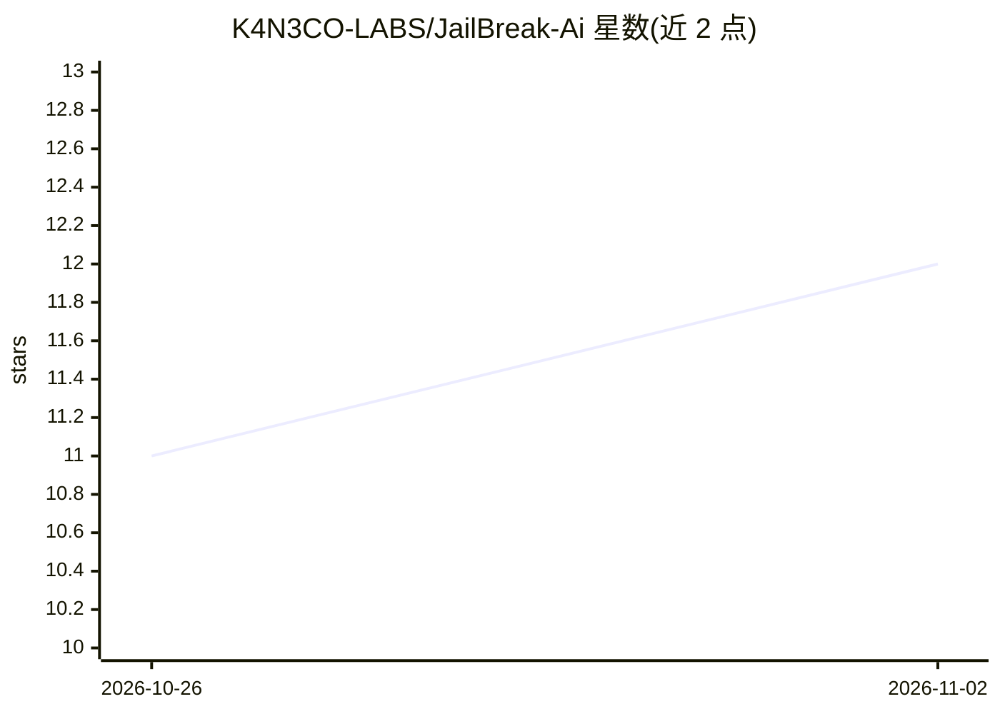

# K4N3CO-LABS/JailBreak-Ai

⭐ 12 · Kotlin · MIT · 推送 2026-07-20 · [GitHub](https://github.com/K4N3CO-LABS/JailBreak-Ai) · 个人维护

**Android 上的 AI 红队工具：生成越狱 payload 提示词**

面向 Android 的 AI 红队测试应用（Kotlin，零依赖）：通过用户提供的 API key（Google AI Studio，每日 1,500 次）调用模型，按选定攻击策略（Narrative Nesting / Logic Paradox / Authority Override）生成针对特定目标模型的越狱 payload 提示词，用户复制粘贴到目标 AI 测试其安全过滤器。内置 Cipher 混淆工具（Base64、L33tsp34k、Token Shuffling）、成功概率颜色分级估计、Exploit Vault 本地保存历史生成。以 Releases 中的 APK 形式分发，声明仅限教育与授权用途。

## 筛选速览

| 维度 | 判定 | 备注 |
|---|---|---|
| AI 角色 | `ai-native` | 本体是模型或模型工具 |
| 许可风险 | `permissive` | MIT |
| 部署形态 | `None` |  |
| 模型依赖 | — | README 未给出锁定关系 |
| 硬件要求 | — | 无带数字的原话,不猜 |
| 安装摩擦 | `low` | 无编译、无系统依赖或容器化 |
| 成熟度 | — | 结构信号不足 |

## 能力要点

- 按 3 种攻击策略生成针对特定模型的 payload 提示词
- Cipher 工具箱：Base64 / L33tsp34k / Token Shuffling 等混淆手段
- 基于目标与策略的成功概率颜色分级估计
- Exploit Vault 本地保存成功生成记录供复用

## 适用场景

- 对自己部署或授权测试的 AI 模型做安全过滤与鲁棒性测试
- 对生成的提示词做混淆处理以测试边界
- 留存并复用历史测试中有效的 payload

## 场景标签

`网络安全` · 领域:学习与行业

## 证据(README 行号)

> L12: **JailBreak-Ai** is an **advanced AI red-teaming app** for **Android**. It generates **high-fidelity payload prompt
> L35: 2. **Get an API Key**: Open the **app** and tap the **link** at **top of home screen** to get a **FREE Google AI St

## 星数曲线

2026-10-26 11 → 2026-11-02 12（+1）

---
*卡片 v1 · prompt 1.4 · 生成 2026-11-02 · 置信度 high · 依据 README sha `23a692d82337` · [字段定义](../../DATASET.md)*
