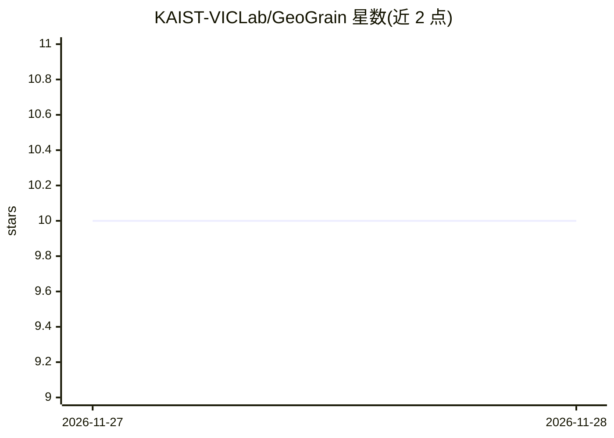

# KAIST-VICLab/GeoGrain

⭐ 10 · 推送 2026-11-27 · [GitHub](https://github.com/KAIST-VICLab/GeoGrain) · [官网](https://kaist-viclab.github.io/GeoGrain_site/) · 组织维护

**面向遥感小目标的粒度感知布局生成图像的论文代码仓库**

KAIST VICLab 的 GeoGrain 论文官方实现仓库，提出一个面向遥感影像小目标的布局到图像（L2I）扩散生成框架：基于预训练 FLUX.2 [klein] 4B Base，包含 GAGE（在 image-token 位置构建含局部几何条件的 layout token）与 GATE（将 OBB 覆盖的网格单元细分为 2×2 细 token）两个机制，并用掩码 flow-matching 损失训练。在 SODA-A 与 AI-TOD-R 数据集上报告布局保真度与生成质量结果。截至当前 README，代码与预训练模型标注为“即将发布”，推理/训练/评测脚本均未开放，仅有项目页可查看对比结果。

## 筛选速览

| 维度 | 判定 | 备注 |
|---|---|---|
| AI 角色 | `ai-native` | 本体是模型或模型工具 |
| 许可风险 | `none` | — |
| 部署形态 | `None` |  |
| 模型依赖 | — | README 未给出锁定关系 |
| 硬件要求 | — | 无带数字的原话,不猜 |
| 安装摩擦 | `low` | 无编译、无系统依赖或容器化 |
| 成熟度 | `idea` | |

## 能力要点

- GAGE：结合全局 OBB 描述与 image-token 位置局部几何条件构建 layout token
- GATE：将 OBB 覆盖的网格单元细分为 2×2 细 token，其余保持粗 token
- 基于冻结的 FLUX.2 [klein] 4B Base，可训练 image–layout 分支
- 生成图像用于数据增强可提升下游检测 AP

## 适用场景

- 按 OBB 布局生成含小目标的遥感影像
- 用生成图像增强小目标检测器的训练数据
- 查阅 SODA-A/AI-TOD-R 上的对比结果与项目页交互演示

## 场景标签

`图像生成` · 领域:内容生成

## 证据(README 行号)

> L18: This repository is the official implementation&nbsp;of
> L31:  Layout-to-image (L2I) generation for remote sensing imagery requires realistic small objects aligned with prescrib
> L68: **The code and pretrained models will be released soon.**

## 星数曲线

2026-11-27 10 → 2026-11-28 10（+0）

---
*卡片 v1 · prompt 1.4 · 生成 2026-11-27 · 置信度 high · 依据 README sha `22127ab39aa5` · [字段定义](../../DATASET.md)*
