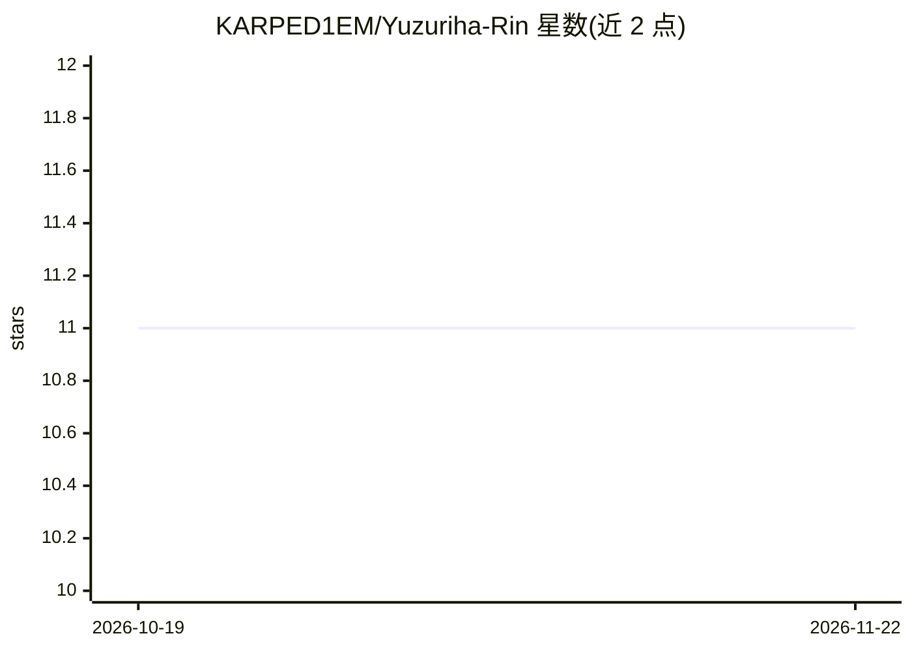

# KARPED1EM/Yuzuriha-Rin

⭐ 11 · Python · MIT · 推送 2025-12-17 · [GitHub](https://github.com/KARPED1EM/Yuzuriha-Rin) · 组织维护 · 中文 README

**以微信风格展示 LLM 聊天的 Web 项目**

ITHM NLP 课程的第 9 组项目，以类微信界面呈现 LLM 聊天。仓库不含模型权重，需先运行随附的训练脚本生成权重后再启动主程序；架构与技术细节在 TECHNICAL_OVERVIEW.md 中说明。README 标注仅供学习用途，外部贡献当前暂停，采用 MIT 许可证发布。

## 筛选速览

| 维度 | 判定 | 备注 |
|---|---|---|
| AI 角色 | `ai-native` | 本体是模型或模型工具 |
| 许可风险 | `permissive` | MIT |
| 部署形态 | `None` |  |
| 模型依赖 | — | README 未给出锁定关系 |
| 硬件要求 | — | 无带数字的原话,不猜 |
| 安装摩擦 | `low` | 无编译、无系统依赖或容器化 |
| 成熟度 | — | 结构信号不足 |

## 能力要点

- 以微信风格界面展示 LLM 聊天
- 提供训练脚本用于生成模型权重
- MIT 许可证
- 提供中英文 README

## 适用场景

- 以微信样式呈现聊天模型的对话效果
- 作为 NLP 课程项目的学习参考

## 场景标签

`聊天机器人` · 领域:对话与助手

## 证据(README 行号)

> L4:  Present the LLM chat in a WeChat-like style
> L18:  Model weights are excluded from the repo; run the bundled training scripts to generate them before launching the m

## 星数曲线

2026-10-19 11 → 2026-11-22 11（+0）

---
*卡片 v1 · prompt 1.4 · 生成 2026-11-19 · 置信度 mid · 依据 README sha `4c1ca3e8de8a` · [字段定义](../../DATASET.md)*
