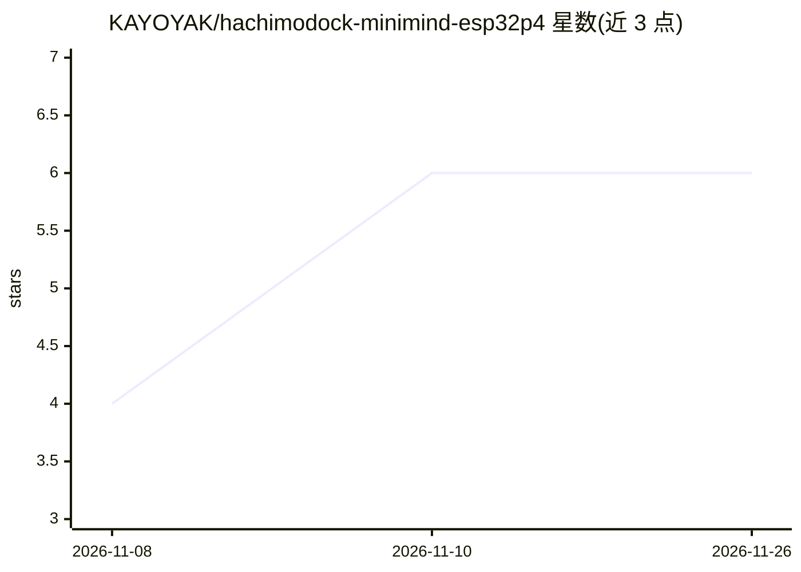

# KAYOYAK/hachimodock-minimind-esp32p4

⭐ 6 · Python · Apache-2.0 · 推送 2026-11-12 · [GitHub](https://github.com/KAYOYAK/hachimodock-minimind-esp32p4) · [官网](https://github.com/KAYOYAK/hachimodock-minimind-esp32p4/releases/tag/v0.1.0) · 个人维护 · 中文 README

**ESP32-P4 上全离线运行自训练 MiniMind 的 AI 桌宠**

将小米开源的 HachimoDock 桌宠设备从“依赖 PC 客户端”改造为独立设备：在 ESP32-P4 单板上运行作者自训练的 MiniMind-3（63.91M 参数），经 LoRA 微调与 q3e4 混合位宽量化压至 28.6 MB 全驻 32 MB PSRAM；基于 Kestrel-MCU 移植推理内核并实现 USB Host 协议桥，按官方 JSONL 协议直接驱动哈基米机，全程无 PC、无网络。推理速度 0.620 tok/s，单句回复需数十秒；无语音 ASR/TTS 与 Agent 状态跟随。需 ESP32-P4 开发板、官方固件哈基米机与 TF 卡，通过 ESP-IDF 构建烧录。

## 筛选速览

| 维度 | 判定 | 备注 |
|---|---|---|
| AI 角色 | `ai-native` | 本体是模型或模型工具 |
| 许可风险 | `permissive` | Apache-2.0 |
| 部署形态 | `None` |  |
| 模型依赖 | — | README 未给出锁定关系 |
| 硬件要求 | — | 无带数字的原话,不猜 |
| 安装摩擦 | `low` | 无编译、无系统依赖或容器化 |
| 成熟度 | — | 结构信号不足 |

## 能力要点

- 自训练 MiniMind-3 + LoRA + q3e4 混合量化，模型 28.6 MB 全驻 PSRAM
- ESP32-P4 端侧推理引擎：零拷贝 GEMV、int16 激活整数点积（累计 3.62× 于 fp32 基线）
- USB Host + CH343 驱动实现官方 JSONL 协议，替代官方 PC 客户端
- 完整离线闭环：摇杆输入 → 本地生成中文 → 屏幕气泡显示

## 适用场景

- 不接电脑、不带网络环境下的离线 AI 桌宠交互
- 研究小模型在 ESP32-P4 上的量化与端侧部署
- 复现从零预训练 + SFT + LoRA + 量化的完整训练链路

## 场景标签

`微调` `推理引擎` `模型量化` `模型训练` · 领域:训练与推理

## 证据(README 行号)

> L1: # HachimoDock × MiniMind × ESP-4P（ESP32-P4）— 全离线桌面 AI 宠物
> L29: 5. **完整闭环**：宠物摇杆输入 → `input/event` → P4 本地生成中文回复 → `speech/text` 气泡 → 宠物屏幕显示，全程离线、无 PC、无网络。
> L219: - 速度 **0.620 tok/s**，单句回复需要数十秒；适合「低频互动」而非实时对话。

## 星数曲线

2026-11-08 4 → 2026-11-26 6（+2）

---
*卡片 v1 · prompt 1.4 · 生成 2026-11-20 · 置信度 high · 依据 README sha `d6f8c7de3d55` · [字段定义](../../DATASET.md)*
