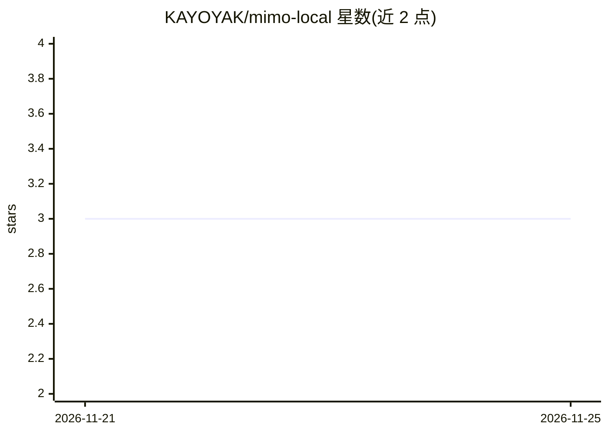

# KAYOYAK/mimo-local

⭐ 3 · Python · Apache-2.0 · 推送 2026-11-21 · [GitHub](https://github.com/KAYOYAK/mimo-local) · 个人维护 · 中文 README

**给个人开发者的全离线本地 AI 编程助手桌面应用**

把三个本地能力拼进一个 PySide6 桌面窗口：MiMo Code 编程 agent 引擎（读写文件、执行命令、多轮工具调用）、MiMo V2.6 9B 主模型（64K 上下文）、Xiaomi-OCR-0 文档识别。聊天前端改造自 DeepSeek 开源的 chat-demo，通过协议桥把 Anthropic Messages 格式翻译成 MiMo Code 的 session API；图片附件由桥自动跑 OCR 后拼进请求。全程不联网、不要账号，仓库不含模型与引擎，需自行准备 llama.cpp 预编译包与模型文件，只支持 Windows + NVIDIA CUDA。

## 筛选速览

| 维度 | 判定 | 备注 |
|---|---|---|
| AI 角色 | `ai-native` | 本体是模型或模型工具 |
| 许可风险 | `permissive` | Apache-2.0 |
| 部署形态 | `desktop` | 安装包/桌面程序 |
| 模型依赖 | — | README 未给出锁定关系 |
| 硬件要求 | `gpu-8g` | |
| 安装摩擦 | `medium` | 含编译或系统依赖之一 |
| 成熟度 | — | 结构信号不足 |

## 能力要点

- MiMo Code + MiMo 9B + Xiaomi-OCR-0 三引擎同时在线，OCR 作为模型可调用的工具
- 协议桥翻译 Anthropic Messages 格式与 MiMo Code session API，桥只监听 127.0.0.1
- 自检 45 项、声明断言、诊断报告等只读工具，显存不足时自动降级上下文与 OCR
- 支持 PyInstaller 打包 exe 及打包后验证脚本

## 适用场景

- 在没有网络的环境下用本地模型做小范围代码改动
- 发收据/文档截图让本地 OCR 识别后由模型基于全文回答
- 在自己的 Windows 电脑上运行一个无需账号的编程助手

## 场景标签

`编码 Agent` `OCR` · 领域:编码与开发

## 证据(README 行号)

> L5:  完全本地的 AI 编程助手
> L7:  不联网 · 不需要账号 · 所有数据在本机
> L22: |**MiMo Code**|AI 编程 agent 引擎（读写文件、执行命令、多轮工具调用）|4096|
> L261: - **只支持 Windows。** 依赖 CUDA / Windows 路径 / cmd。

## 星数曲线

2026-11-21 3 → 2026-11-25 3（+0）

---
*卡片 v1 · prompt 1.4 · 生成 2026-11-22 · 置信度 high · 依据 README sha `3cb9716e4e88` · [字段定义](../../DATASET.md)*
