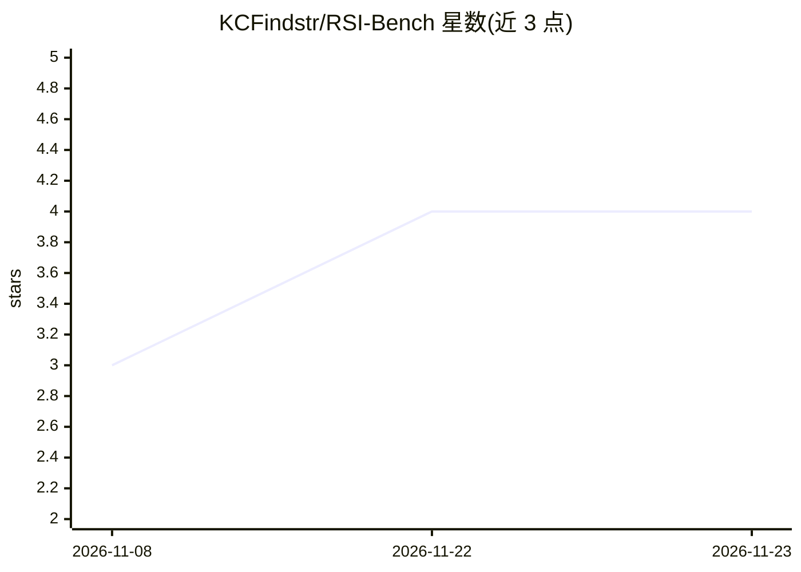

# KCFindstr/RSI-Bench

⭐ 4 · Python · MIT · 推送 2026-11-01 · [GitHub](https://github.com/KCFindstr/RSI-Bench) · 个人维护

**多轮评测框架：测基础模型生成随机整数的随机性**

RSI-Bench 是一个经验性多轮评测框架，让模型每轮生成一个随机整数并对求和结果计算 RSI 指数，以探测基础模型的随机性。提供 symlog 归一化的指数分布图与逐轮累计轨迹图，收录 28 个经统一推理端点评测的模型结果。通过 git clone 源码加 pip 安装依赖运行，模型路由经 OpenRouter 统一接入，支持配置文件定义评测项与零成本离线模拟模式，图表输出为 HTML 与 PNG 两种格式。MIT 许可。

## 筛选速览

| 维度 | 判定 | 备注 |
|---|---|---|
| AI 角色 | `ai-knowledge` | 知识聚合/清单类 |
| 许可风险 | `permissive` | MIT |
| 部署形态 | `library` | 以包/库形式分发 |
| 模型依赖 | locked-api |  |
| 硬件要求 | — | 无带数字的原话,不猜 |
| 安装摩擦 | `low` | 无编译、无系统依赖或容器化 |
| 成熟度 | — | 结构信号不足 |

## 能力要点

- 多轮随机整数生成求和的 RSI 指数评测机制
- symlog 归一化指数分布与逐轮性能轨迹图
- 28 个模型经 OpenRouter 统一端点评测
- 支持 --mock 零成本离线模拟运行

## 适用场景

- 对多个基础模型跑同一随机性评测脚本
- 复现评测并生成交付用的指数与轨迹图表
- 在调用真实 API 前用离线模式验证流程

## 场景标签

`模型评测` · 领域:评测与运维

## 证据(README 行号)

> L11: **RSI-Bench** (**R**andom **S**equence of **I**ntegers Benchmark) is an empirical multi-turn evaluation framework t
> L31: The benchmark evaluates 28 frontier and production foundation models via unified inference endpoints:
> L66: ### 1. Installation

## 星数曲线

2026-11-08 3 → 2026-11-23 4（+1）

---
*卡片 v1 · prompt 1.4 · 生成 2026-11-22 · 置信度 high · 依据 README sha `1c5e0399dceb` · [字段定义](../../DATASET.md)*
