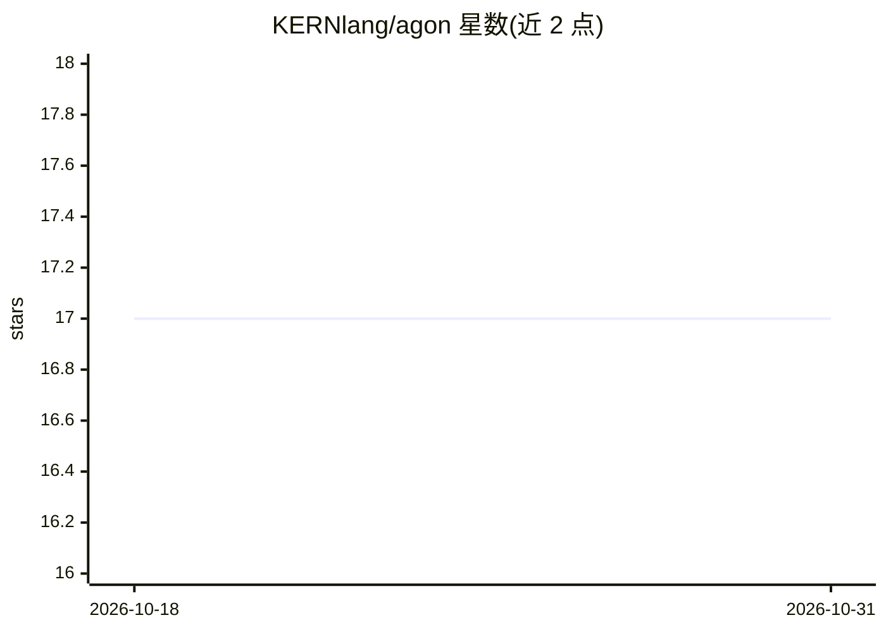

# KERNlang/agon

⭐ 17 · TypeScript · MIT · 推送 2026-10-30 · [GitHub](https://github.com/KERNlang/agon) · [官网](https://kernlang.com/agon) · 个人维护

**多 AI 引擎竞争协作编排 CLI：竞速写码、合议决策**

面向开发者的终端多 AI 引擎编排工具（npm 全局安装，TypeScript ESM）。同一任务分发给多个 AI 编码引擎（如 Claude Code、Codex 等 CLI），在隔离的 git worktree 中并行实现，最优方案自动合并回主分支；编排层 Cesar 基于每引擎的 Glicko-2 评分按任务类别路由。另提供协作模式：brainstorm、synthesis、tribunal、council、review 共识、mutation 测试、research（免 API key 带引用核验）等二十余种。要求 Node.js >= 22 与 git 仓库，至少一个受支持的 AI CLI；Python 3.10+ 为可选（语义功能回退到子串/正则路径）。

## 筛选速览

| 维度 | 判定 | 备注 |
|---|---|---|
| AI 角色 | `ai-ecosystem` | LLM/agent 周边工具 |
| 许可风险 | `permissive` | MIT |
| 部署形态 | `library` | 以包/库形式分发 |
| 模型依赖 | locked-api |  |
| 硬件要求 | — | 无带数字的原话,不猜 |
| 安装摩擦 | `medium` | 含编译或系统依赖之一 |
| 成熟度 | — | 结构信号不足 |

## 能力要点

- 多引擎在同一任务上竞争，隔离 git worktree，胜出方案自动应用
- Cesar 基于 Glicko-2 评分按任务类别动态路由引擎
- 20+ 模式：brainstorm/synthesis/tribunal/council/review/mutate/research 等
- research 模式免 API key，自动发现来源并核验每条引用

## 适用场景

- 让多个 AI 编码引擎竞争实现同一任务并自动采纳最优方案
- 重大架构决策前召集多引擎辩论或圆桌评审
- 长任务队列无人值守执行（build→witness→gate→review→commit）

## 场景标签

`编码 Agent` `多智能体` · 领域:Agent 开发

## 证据(README 行号)

> L12: Agon AI puts the world's best AI engines on your software engineering problems two ways. They **compete** on implem
> L30: Routing these tasks efficiently is **Cesar**, Agon's intelligent orchestration brain. Cesar monitors every interact

## 星数曲线

2026-10-18 17 → 2026-10-31 17（+0）

---
*卡片 v1 · prompt 1.4 · 生成 2026-10-30 · 置信度 mid · 依据 README sha `981357a47063` · [字段定义](../../DATASET.md)*
