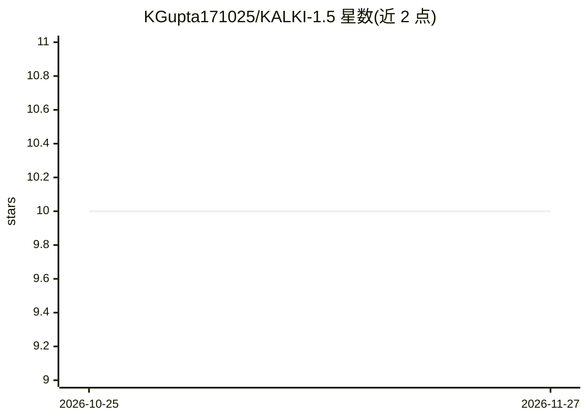

# KGupta171025/KALKI-1.5

⭐ 10 · HTML · MIT · 推送 2026-11-22 · [GitHub](https://github.com/KGupta171025/KALKI-1.5) · 个人维护

**面向企业的多智能体智能操作系统：整合 LLM、RAG 与防御性安全**

自称统一 AI 生态系统的项目，组合 LLM/VLM/SLM、MoE 任务路由、基于 MCP 与 A2A IPC 的多智能体编排、混合 RAG（RRF 融合稠密检索与 BM25 并经 Cross-Encoder 重排序）、分层记忆与防御性网络安全。架构分 7 层，覆盖 Web/移动/桌面/智能手表/边缘 IoT 多端形态，docs/ 目录提供架构、数据库、API、部署等规格文档。通过 Docker Compose 启动 FastAPI 后端、Next.js 前端、PostgreSQL、Redis 与 Qdrant 全栈。

## 筛选速览

| 维度 | 判定 | 备注 |
|---|---|---|
| AI 角色 | `ai-ecosystem` | LLM/agent 周边工具 |
| 许可风险 | `permissive` | MIT |
| 部署形态 | `self-host` | docker 或自建部署 |
| 模型依赖 | — | README 未给出锁定关系 |
| 硬件要求 | — | 无带数字的原话,不猜 |
| 安装摩擦 | `low` | 无编译、无系统依赖或容器化 |
| 成熟度 | `idea` | |

## 能力要点

- Planner/Research/Memory/Executor/Validator/Security 六类 agent 经 MCP 与 A2A 通信
- 混合 RAG：RRF 融合稠密向量检索与 BM25，Cross-Encoder 重排序
- 分层记忆：短期上下文、长期偏好、语义嵌入、情节与程序性 DAG
- 内置安全审计工具、SAST/DAST 报告与异常检测

## 适用场景

- 搭建带引用与混合检索的企业知识问答系统
- 运行多智能体编排的自动化研究与执行流程
- 对系统做防御性安全审计与异常检测

## 场景标签

`多智能体` `RAG` `网络安全` · 领域:Agent 开发

## 证据(README 行号)

> L11: **KALKI AI** (**Krishna Artificial Lattice Keystone Intelligence**) is a next-generation, unified artificial intell
> L25: - **Autonomous Multi-Agent Orchestration**: Specialized Planner, Research, Memory, Executor, Validator, and Securit

## 星数曲线

2026-10-25 10 → 2026-11-27 10（+0）

---
*卡片 v1 · prompt 1.4 · 生成 2026-11-20 · 置信度 mid · 依据 README sha `8f11aebf99c9` · [字段定义](../../DATASET.md)*
