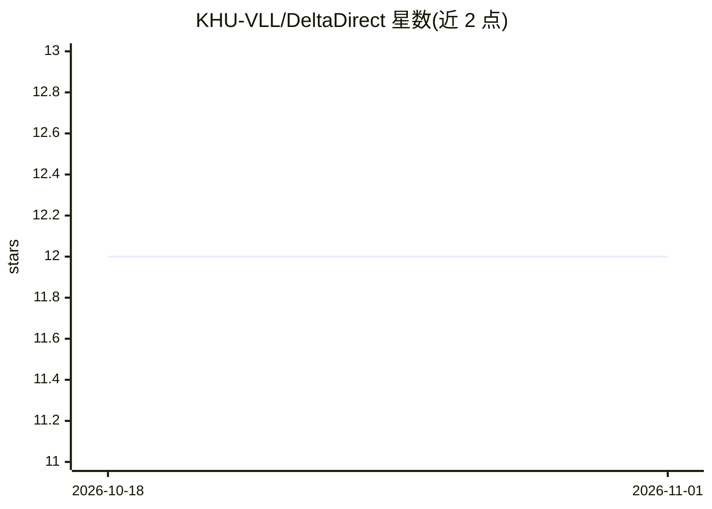

# KHU-VLL/DeltaDirect

⭐ 12 · Python · Apache-2.0 · 推送 2026-10-06 · [GitHub](https://github.com/KHU-VLL/DeltaDirect) · [官网](https://jong980812.github.io/which-way-did-it-move/) · 组织维护

**修正 Video-LLM 运动方向盲区的训练目标与数据集实现**

NeurIPS 2026 论文的 PyTorch 官方实现：提出 DeltaDirect 训练目标，基于帧间特征变化教 LLaVA-Video-7B 表达运动方向，仅用合成视频训练即使 SynBench 准确率从 25.9% 升至 85.9%、RealBench 提升 21.4 点。仓库提供 conda/pip 安装、训练脚本（可切换基线）、checkpoint 加载代码，以及 MoDirect 数据集（10 万条带方向标注的指令微调数据与含 SynBench/RealBench 的多选基准）。面向视频理解研究者。

## 筛选速览

| 维度 | 判定 | 备注 |
|---|---|---|
| AI 角色 | `ai-native` | 本体是模型或模型工具 |
| 许可风险 | `permissive` | Apache-2.0 |
| 部署形态 | `library` | 以包/库形式分发 |
| 模型依赖 | — | README 未给出锁定关系 |
| 硬件要求 | — | 无带数字的原话,不猜 |
| 安装摩擦 | `low` | 无编译、无系统依赖或容器化 |
| 成熟度 | — | 结构信号不足 |

## 能力要点

- DeltaDirect 训练目标：从帧间特征变化学习方向绑定
- MoDirect-Inst：100K 合成视频指令数据，含逐帧 2D 运动向量标注
- MoDirect-Bench：SynBench 与 RealBench 多选基准（SSv2/KTH/TOMATO）
- 提供 LLaVA-Video-7B 训练脚本与基线对照开关

## 适用场景

- 我要复现或改进 Video-LLM 的运动方向理解训练
- 我想用 MoDirect 基准评测视频模型的方向判断能力
- 我在做视频指令微调并需要带方向真值的数据集

## 场景标签

`模型评测` `微调` `图像视频处理` · 领域:评测与运维

## 证据(README 行号)

> L15: PyTorch implementation of **DeltaDirect** for instruction tuning LLaVA-Video-7B on MoDirect-Inst, with a baseline t
> L17: Video-LLMs often cannot tell which way an object moves, a failure we call *directional motion blindness*. We trace 

## 星数曲线

2026-10-18 12 → 2026-11-01 12（+0）

---
*卡片 v1 · prompt 1.4 · 生成 2026-11-01 · 置信度 mid · 依据 README sha `0b40073b303e` · [字段定义](../../DATASET.md)*
