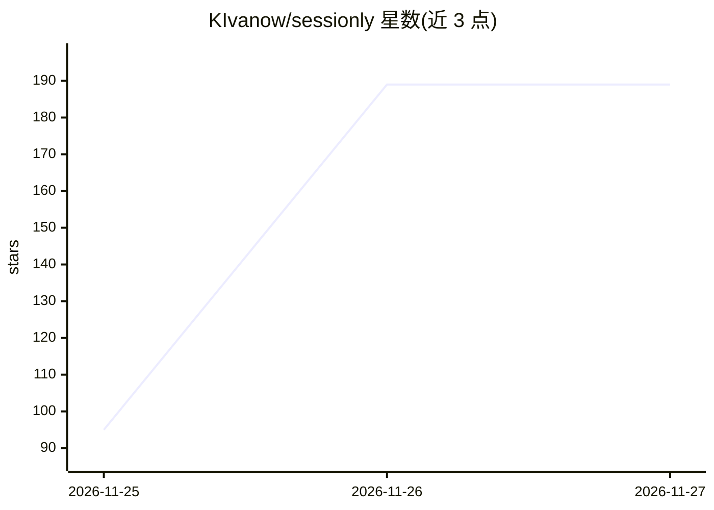

# KIvanow/sessionly

⭐ 189 · TypeScript · Apache-2.0 · 推送 2026-11-26 · [GitHub](https://github.com/KIvanow/sessionly) · [官网](https://sessionly.dev) · 组织维护

**本地优先的编码 agent 会话台账：记录成本与代码留存率**

以本地 Rust 二进制形式记录 Claude Code、Codex、Cursor、Grok 的会话：通过 hooks 或读取 agent 自身的会话文件采集工具调用、文件变更、token 与成本，归一化为 ~/.sessionly 下的 SQLite 台账；统计 agent 写入的行在后续文件和 pull request review 后的留存比例。数据默认留在本机，上传需显式连接服务器且不发送源码。提供 GitHub Action 关联 PR 与团队 dashboard，服务器可自托管。ee/ 目录含商业版功能。

## 筛选速览

| 维度 | 判定 | 备注 |
|---|---|---|
| AI 角色 | `ai-ecosystem` | LLM/agent 周边工具 |
| 许可风险 | `permissive` | Apache-2.0 |
| 部署形态 | `self-host` | docker 或自建部署 |
| 模型依赖 | — | README 未给出锁定关系 |
| 硬件要求 | — | 无带数字的原话,不猜 |
| 安装摩擦 | `low` | 无编译、无系统依赖或容器化 |
| 成熟度 | — | 结构信号不足 |

## 能力要点

- 四个 agent 的会话归一化为同一记录格式
- 以代码行留存率（含 PR review 后）替代行数统计
- 捕获、解析与脱敏在本地完成，源码永不上传
- 台账为派生数据，删除后可由 sync --force 重建

## 适用场景

- 统计团队各编码 agent 的会话成本与用量
- 评估 agent 生成代码在 review 后的留存情况
- 自托管 dashboard 汇总多人 agent 使用记录

## 场景标签

`LLM 可观测性` · 领域:评测与运维

## 证据(README 行号)

> L5:  A lab-neutral, local-first ledger for Claude Code, Codex, Cursor and Grok sessions.
> L104: 1. **Capture.** A hook appends each agent event to a local file in 2–4 ms. It only observes: it
> L108: 3. **Normalize.** Both become one record per session in a local SQLite ledger at `~/.sessionly`:

## 星数曲线

2026-11-25 95 → 2026-11-27 189（+94）

---
*卡片 v1 · prompt 1.4 · 生成 2026-11-26 · 置信度 high · 依据 README sha `38d6c3ba37b9` · [字段定义](../../DATASET.md)*
