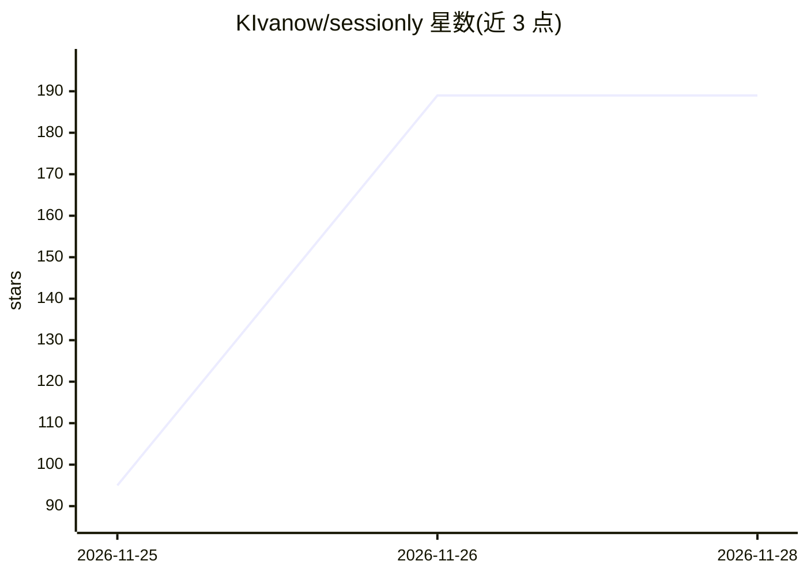

# KIvanow/sessionly

⭐ 189 · TypeScript · Apache-2.0 · 推送 2026-11-27 · [GitHub](https://github.com/KIvanow/sessionly) · [官网](https://sessionly.dev) · 组织维护

**本地记账 Claude Code/Codex/Cursor 等 Agent 会话的工具与开销**

以本地优先方式为 Claude Code、Codex、Cursor、Grok 和 OpenCode 的会话建立台账：通过钩子捕获 Agent 事件，从各 Agent 自身的转录与会话文件读取 token、模型与费用，规范化为 ~/.sessionly 下的 SQLite 记录，并统计 Agent 写入的代码行在后续文件与 PR 评审后的留存率。可选连接服务器做团队仪表盘，默认所有捕获与解析在本地完成，上传需显式开启且不发送源代码。以 Rust 二进制与 crates.io 包形式分发，CLI 提供 list/summary/show 等命令。

## 筛选速览

| 维度 | 判定 | 备注 |
|---|---|---|
| AI 角色 | `ai-ecosystem` | LLM/agent 周边工具 |
| 许可风险 | `permissive` | Apache-2.0 |
| 部署形态 | `self-host` | docker 或自建部署 |
| 模型依赖 | — | README 未给出锁定关系 |
| 硬件要求 | — | 无带数字的原话,不猜 |
| 安装摩擦 | `low` | 无编译、无系统依赖或容器化 |
| 成熟度 | — | 结构信号不足 |

## 能力要点

- 五个 Agent 的会话统一映射为同一会话记录格式
- 统计 Agent 写入行的留存率（文件中与 PR 评审后）
- 本地捕获与脱敏，上传可选且默认不含提示词/命令/文件文本
- GitHub Action 上报 PR 中 Agent 编写比例与模型信息

## 适用场景

- 统计团队使用各类编码 Agent 的开销与活跃时长
- 追踪 Agent 提交的代码在评审后的留存情况
- 在自建服务器上聚合团队的 Agent 会话仪表盘

## 场景标签

`LLM 可观测性` · 领域:评测与运维

## 证据(README 行号)

> L22: Sessionly keeps a ledger of your Claude Code, Codex, Cursor, Grok and OpenCode sessions, on your own
> L55: - **Lab-neutral.** Sessionly is not any agent maker's tool. It reads every agent's sessions the
> L104: 1. **Capture.** A hook appends each agent event to a local file in 2–4 ms. It only observes: it

## 星数曲线

2026-11-25 95 → 2026-11-28 189（+94）

---
*卡片 v1 · prompt 1.4 · 生成 2026-11-27 · 置信度 mid · 依据 README sha `08f42d398317` · [字段定义](../../DATASET.md)*
