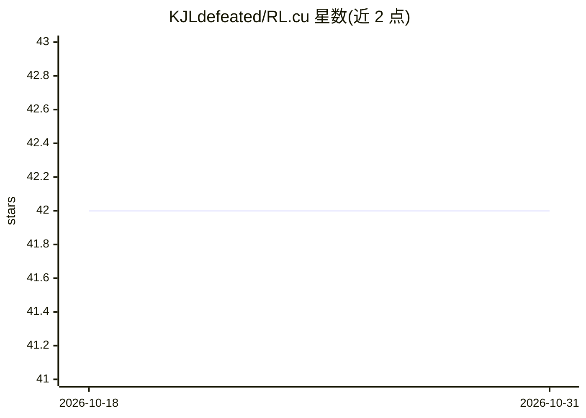

# KJLdefeated/RL.cu

⭐ 42 · Cuda · MIT · 推送 2026-07-25 · [GitHub](https://github.com/KJLdefeated/RL.cu) · 个人维护

**纯 CUDA/C++ 实现的 LLM 强化学习训练与推理框架**

从零用 CUDA/C++ 实现 LLM RL 全流程：手写 FlashAttention-2、RMSNorm、RoPE、SwiGLU、AdamW、GRPO loss 等前向+反向内核，Qwen3-0.6B 模型加载（safetensors），vLLM 风格推理引擎（连续批处理、分页 KV cache、CUDA graphs），以及 SFT 与 GRPO 训练循环。推理与训练同进程共享权重，无需权重同步。需要 CUDA Toolkit >= 12.0、CMake >= 3.18、Ampere 及以上 GPU（sm_80+），通过 git clone 源码构建，无 Python 运行时依赖。附与 TRL (vLLM backend) 的基准对比数据。

## 筛选速览

| 维度 | 判定 | 备注 |
|---|---|---|
| AI 角色 | `ai-ecosystem` | LLM/agent 周边工具 |
| 许可风险 | `permissive` | MIT |
| 部署形态 | `library` | 以包/库形式分发 |
| 模型依赖 | — | README 未给出锁定关系 |
| 硬件要求 | — | 无带数字的原话,不猜 |
| 安装摩擦 | `high` | 编译与系统依赖俱全 |
| 成熟度 | — | 结构信号不足 |

## 能力要点

- 手写 CUDA 内核含前向+反向（FlashAttention-2、RMSNorm、RoPE、AdamW、GRPO loss 等）
- vLLM 风格推理引擎：连续批处理、分页 KV cache、CUDA graph 捕获
- SFT + GRPO 训练循环，梯度检查点与混合精度 AdamW
- 推理与训练同进程共享权重，train-inference mismatch 为 0

## 适用场景

- 研究 CUDA 内核级实现 LLM 训练与推理的完整流程
- 在单 GPU 上对 Qwen3-0.6B 做 GRPO/SFT 训练
- 学习 FlashAttention-2、分页 KV cache 等内核与引擎设计

## 场景标签

`推理引擎` `强化学习` `微调` · 领域:训练与推理

## 证据(README 行号)

> L20: A from-scratch implementation of the complete LLM RL pipeline — hand-written CUDA kernels, a vLLM-style inference e
> L30: |**Training**|SFT + GRPO with gradient checkpointing, mixed-precision AdamW|
> L146: ### GRPO (Group Relative Policy Optimization)

## 星数曲线

2026-10-18 42 → 2026-10-31 42（+0）

---
*卡片 v1 · prompt 1.4 · 生成 2026-10-25 · 置信度 mid · 依据 README sha `e1eec26505b2` · [字段定义](../../DATASET.md)*
